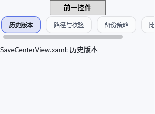
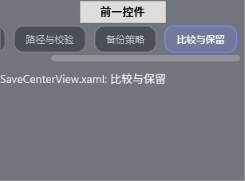
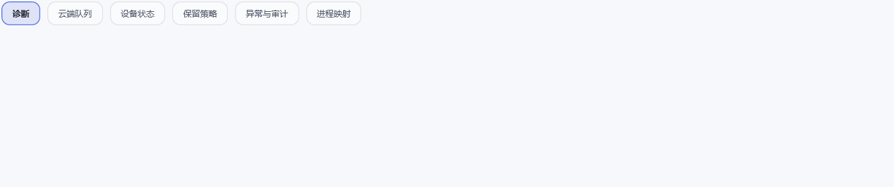

# Q11-06 当前 main 页签溢出视觉复核（2026-10-17）

## 结论

在当前共享 `GscRedesignWorkspaceTabControl` / `GscRedesignWorkspaceTabItem` 生产资源上，完成了浅色、深色下四个页面的窄视口首末页签截图，以及 Maintenance 宽视口截图，共 18 张。受控视觉栏记为“受控通过”；宿主仍为“外部阻塞”，Q11-06 最终仍未完成。

本轮只在 `R23ProductionResourceStateBehaviorTests` 增加环境变量 opt-in 的截图和几何报告；没有修改生产 XAML、导航、绑定或命令。测试内容仍来自 2026-09-29 已有 Q11-06 行为夹具，本轮在当前 main 输入上重新执行同一行为断言并附加视觉输出。

## 夹具与观察

- 读取四个生产页面的顶层页签标题：Save Center `4`、Media Center `4`、Maintenance `6`、Trainer Center `4`；加载生产共享 TabControl/TabItem 样式与运行时 Light/Dark 资源。
- 窄窗口请求 `320×240 DIP`，根节点实测 `306.67×226.67 DIP`。四页在两主题下均有可见 `12 DIP` 水平滚动条；首页偏移为 `0`，末页偏移分别为 Save `74`、Media `62`、Maintenance `215.33`、Trainer `100 DIP`。几何明细见 [`q11-06-tab-overflow-captures.txt`](q11-06-tab-overflow-captures.txt)。
- Maintenance 宽窗口请求 `1280×280 DIP`，根节点实测 `1266.67×266.67 DIP`；六个标题完整同屏，滚动条折叠。
- 人工复核了 Light/Dark 的首末页签和 Maintenance 宽布局图：当前项、共享页签 chrome、滚动条与主题表面均可见，未发现标签被裁切或横向偏移。完整 18 张图均在本目录。
- 页面主体是测试占位内容；`RenderTargetBitmap` 以 96 DPI 离屏渲染。不是 Playnite 页面截图、物理屏幕帧或物理 DPI 测量。

窄布局截图示例：

| 浅色首项 | 深色末项 |
| --- | --- |
|  |  |

| Maintenance 浅色宽布局 | Maintenance 深色宽布局 |
| --- | --- |
|  |  |

## 构建与运行身份

- 仓库基线：`main`，`1662e27b6f41ba00b78388589267691d4def7b6f`。本机 SDK 选择为 `9.0.302`（仓库要求的 `8.0.423` 未安装）；VSTest `17.14.1`，测试宿主 `.NET Framework 4.8.9181.0`。
- Playnite `net462` 与测试项目 `net472` 的定向 Release `dotnet test` 构建成功；`WorkspaceTabOverflowKeepsProductionHeadersMouseAndKeyboardReachableInBothThemes` `1/1` 通过，耗时 `24.1865s`。脱敏/可复核结果：[TRX](tests/q11-06-tab-overflow-final.trx)。
- 测试运行时，本阶段截图夹具改动尚未提交；精确测试源由 SHA-256 绑定。`GscBuildCommit` 元数据为基线 `1662e27b`，源码根为本仓库。代码与证据已提交并推送为 `1c60a2fc61fae6109a609fd14c4977dfb927a32c`。Actions [#1059/run `38982569941`](https://github.com/Nikilua/GameSaveCenter/actions/runs/38982569941) 已整体成功：SDK8.0.423 job `117246575824` 与 SDK10.0.401 job `117246576000` 均完成 Release build，Core `125/125`、Worker `362/362`、Playnite source `107` 类、WPF 隔离 `125` 类通过（含 R09 类）。SDK8 另完成 `render-qa OK`、静态审查 `30 XAML / 0 errors / 27 warnings / 177 info`、扩展包生成与上传；package artifact `12083640501`，diagnostics artifact `12083485726`。修正 TRX 隐私字段并同步状态的文档提交 `d62e199f` 对应 [#1060/run `38983018226`](https://github.com/Nikilua/GameSaveCenter/actions/runs/38983018226) 也已整体成功。SDK9 本机结果与这两组干净 runner 结果分开记录；这些 CI 结果都不代表另一台机器的实际安装/测试输入。
- 测试源码 SHA-256：`94347B788C770CD4D30FD3AFA161F751DD17EA724748C35CA37F028F89F56BA9`。
- 生产共享模板 `Redesign.xaml` SHA-256：`3E311AEAE281E20D004BA395A5EED08E1C813FFB44994087645356A91865FE98`。
- 测试 DLL SHA-256 / MVID：`85BEE36D6A47A474080FB01F817547A4AE4F2961081A9B0CDD78150EC366A035` / `0e9d7248-59ef-45f3-a1c0-f75f98cee6d9`；PDB SHA-256：`85D799F6948C408DEE7FA18FE7638918BA4C997F50F3BE9C549F0461EAAEF739`。
- 插件 DLL SHA-256 / MVID：`362EF4CC27A6464F1FF8D2CF658AF7324D9A04B97B40E88B87C30D8F51D5EB63` / `d501a1ef-470f-47ae-a14c-978b69dd6065`。
- 提交前已对 TRX 中的本机用户名、主机名和仓库绝对路径脱敏；测试名、通过结果、计数与时间保持不变。
- 在最新 HEAD `d62e199fed5adf002fbf762f3a8ea0a770da46fd` 重新检查 R00/R01 freshness：`14 fresh / 0 stale / 0 matched source paths`，比较路径 `2,949`，package identity `not-provided`。精简结果及 SHA-256 `5EA4EE4BEAB3E99B7A51B267B435491BACA73929E49DBECA18776B396B4D2A1A` 见 [`r00-r01-freshness-summary.json`](r00-r01-freshness-summary.json)。
- 本目录每张 PNG、TRX 与几何报告的 SHA-256 见 [`SHA256SUMS.txt`](SHA256SUMS.txt)。

## 未验证边界

现有行为断言通过 WPF STA 窗口中的 routed keyboard/mouse 事件和真实 ScrollBar `RepeatButton.OnClick` 验证可达性；不是 OS 物理键鼠输入。没有加载完整生产页面 ViewModel，也没有运行真实 Playnite。实际宿主 DPI、UI Automation/读屏、最终屏幕呈现与跨屏仍待环境验收。

用户提供的另一台机器 R09 失败仍是单独的真实失败；该附件 SHA-256 与先前文本相同，期望 `Thickness(2)`/实际 `Thickness(1)` 的行和值仍对应历史测试形态，而当前 main 同一行是 Brush 颜色断言。SDK8/SDK10 当前 main clean-runner R09 类通过不能证明外机那次成功或解释两者的输入差异；仍缺同次 `summary.json`、HEAD、源码、测试 DLL/PDB 与插件 DLL 身份。本证据不声称修复或覆盖那次外机失败。
