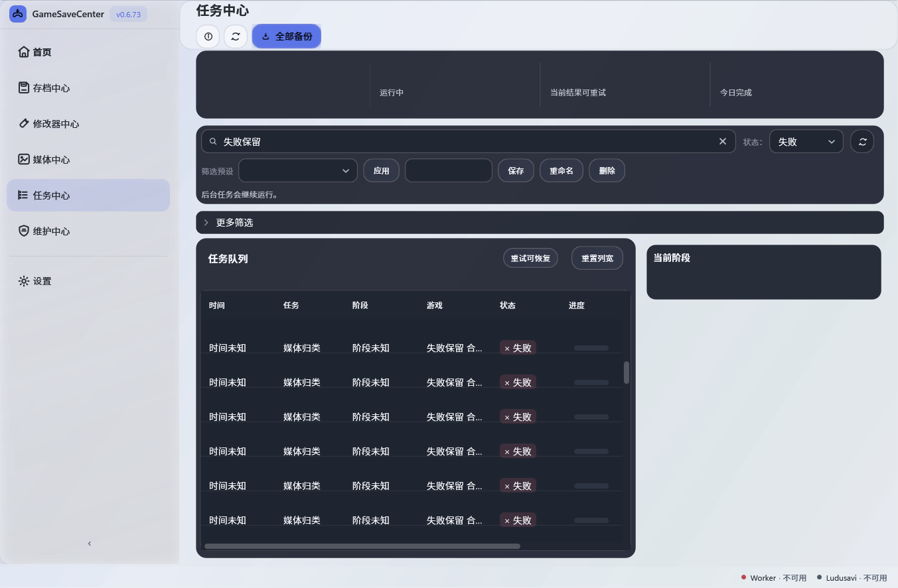
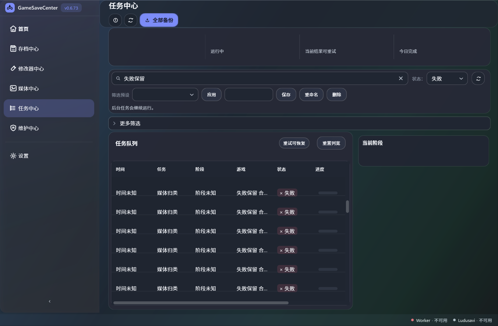
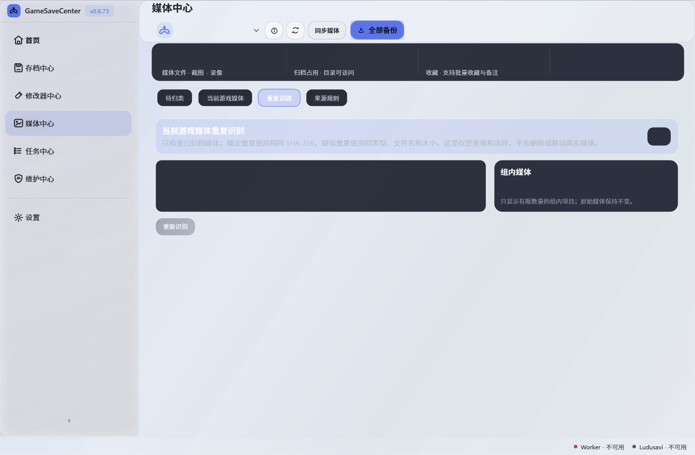
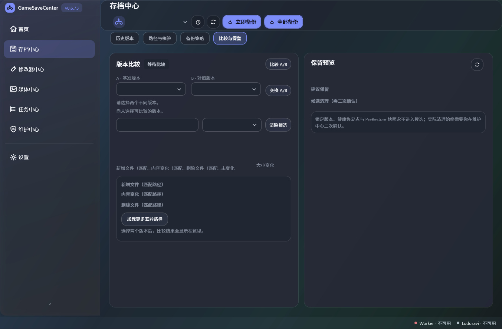
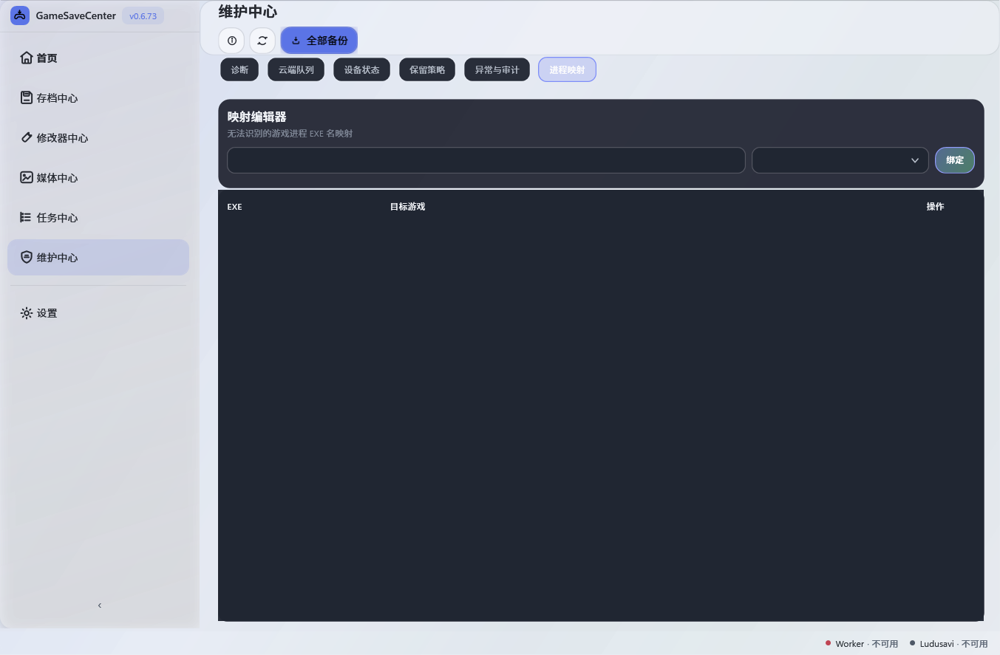
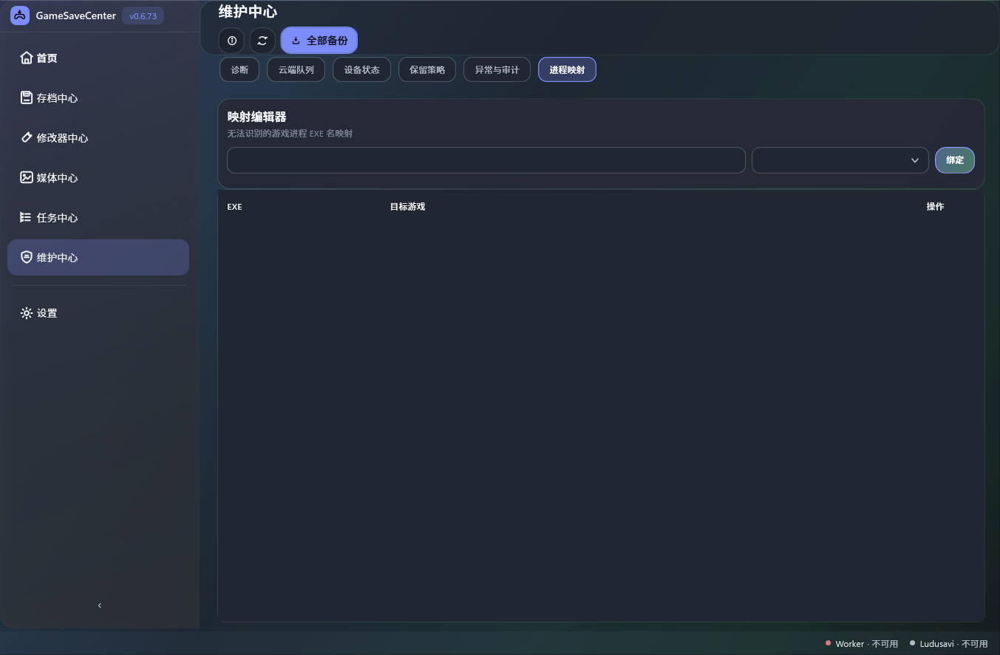

# Q11-07 当前 main 工作区往返复核（2026-10-17）

## 结果与状态

Q11-07 已有的生产缓存与绑定实现继续满足状态往返行为。本次在现有 `R08PageSwitchBehaviorTests` 中增加 opt-in 离屏截图输出，对 Task、Media、Save、Maintenance 四个真实生产页实例在工作区往返后分别渲染 Light/Dark，共 8 张图。没有修改生产 XAML、服务、DTO、命令或导航实现。

Round2 的受控行为与视觉证据记为通过；Playnite 宿主、有效物理 DPI 和屏幕最终呈现仍待验，因此 Q11-07 保持外部阻塞，最终状态未完成。

## 行为及截图覆盖

- 测试沿用 96 个合成 `TaskStatusDto`，实际更改搜索和四个筛选器，并将 Media/Save/Maintenance 选中索引设为 `2/3/5`；随后离开工作区再返回，断言筛选值、三个 Tab 索引、缓存页/控件引用、选中任务、18 DIP 滚动偏移、DataContext 与集合引用均保留，合成刷新命令执行 `0` 次。
- 渲染前再次核对上述状态。浅色和深色各截取四个返回后的生产页面，报告列出窗口、页、筛选/Tab 状态和对应文件。图像由 WPF `RenderTargetBitmap` 在 96 DPI 离屏产生；不是桌面截图、真实 Playnite 呈现、有效物理 DPI 或 presented-frame 证据。
- Task Center 的选中项是 `q11-07-task-55`，但当前滚动偏移只有 `18 DIP`，该行不在截图视口内。选中身份由行为断言验证，截图不据此声称选中行可见。
- 测试没有连接 Worker、仓库、Playnite profile 或业务查询服务。截图中 Worker/Ludusavi 的不可用提示来自隔离夹具状态，不代表真实服务状态。
- 截图示例：

| Task Center 浅色 | Task Center 深色 |
| --- | --- |
|  |  |

| Media Center 浅色 | Save Center 深色 |
| --- | --- |
|  |  |

| Maintenance 浅色 | Maintenance 深色 |
| --- | --- |
|  |  |

## 构建与输入身份

- 仓库基线为 `main` / `57023ac849689dab0d2b999737e0213042a1eebc`。本机选择的 SDK 为 `9.0.302`、VSTest `17.14.1`、测试宿主 .NET Framework `4.8.9181.0`；目标仍是 Playnite `net462` 与测试项目 `net472`。这不是仓库 CI 的 SDK8 或 SDK10 结果。
- 本机隔离 Release build 后，`R08PageSwitchBehaviorTests` 类为 `4/4` 通过、0 失败/跳过。证据 TRX 为脱敏副本。最初一次构建把身份守卫参数写成 `57023ac-dirty-q11-07`，守卫按规则拒绝该次结果；随后在独立输出目录用真实 HEAD `57023ac849689dab0d2b999737e0213042a1eebc` 重建和运行，4/4 通过。测试源当时有一项未提交改动，故同时以源文件 SHA 绑定实际输入；提交后仍须用提交后的身份复核。
- 实际测试源 SHA-256：`6B46ADE6C82FE6DF26466BBB95406F0CAEA96423BEBC9AB862031CC062237222`。测试 DLL SHA-256/MVID：`3D9387A4A78459FCC375623A200BBF3F56D7E2A46FEB10EF72A5F28E9ED2679` / `e2c0eb78-7069-4453-a629-683b0e0e6f44`；测试 PDB SHA-256：`0F3E30A31CFA15FD602C72E0779F95587D489B2D72A335E3CD2ADC1E4DD68C1D`。插件 DLL SHA-256/MVID：`6D16939BE42D43028E690509E8565DC1D927E32FEAB7FBE3D6A33A06921B9588` / `83e1dac9-a591-4c45-b64c-7c52cf7e89e0`；插件 PDB SHA-256：`8FBECF49EA00FA7B6807EE985E1B426F715F536C52AE70225FCA81F7E766A4EC`。程序集版本均为 `0.6.73.0`。
- 生产输入未修改；本次测试所读文件身份：`AcrylicProductionShellView.xaml.cs` `736C1554D06C8B67E753F68FBFB0E2F63935F007414BA9F45BB1E29D35AE39C7`、对应 XAML `B9E7A777B84F4AC3DD08FEF69643D7F64D7632466F3DC0271239F8792B756089`、TaskCenter `00EBAC27AB45A858BBF9107DE60C64C28DA8F95C70CB3FB8425A6ACE5D65C0E2`、MediaCenter `6017064AFF472B2EC92E6A82E0355DFCCE1FD5FE151A795D80EC3C3E7A1558D5`、SaveCenter `4A86836BB5FB4CDA36DD2E4085F43A345EB9F2ABDBFDD1C7C96CE5CA8DC718F9`、Maintenance `932C3364F133EF7AFAEDE4113BC2C784420A0AAAEA16D7545D752CAD290AB282`、`Themes/Redesign.xaml` `3E311AEAE281E20D004BA395A5EED08E1C813FFB44994087645356A91865FE98`。
- R00/R01 freshness 脚本结果为 `14 fresh / 0 stale / 0 matched source paths`，2,949 个比较路径，package identity `not-provided`。此项只核对已登记证据的源码 freshness，不构成构建或宿主验证。精简原始结果见 [`r00-r01-freshness-summary.json`](r00-r01-freshness-summary.json)。
- 旧基线 #1061/run `38986851956`（提交 `57023ac`）的 SDK10.0.401 job `117260206331` 已成功，日志末尾确认该 lane Release build/test 与125个隔离 WPF 类通过；SDK8.0.423 job `117260206566` 在记录时仍处于编译/测试。该 run 没有包含本次未提交的 Q11-07 测试改动，不能作为新源码 CI 证据。SDK9 本机通过不能预判或替代新代码 CI，也不能证明用户另一台电脑的输入成功。
- 本目录截图、报告、freshness JSON 与脱敏 TRX 的 SHA-256 见 [`SHA256SUMS.txt`](SHA256SUMS.txt)。

## 外机 R09 失败边界

另一台电脑一键流程报告真实 exit `1`、R09 `1/2`。其失败文本行号/`Thickness(2/1)` 与当前 main 的测试源码和已有 CI 输入不一致，具体 checkout、test DLL/PDB、插件 DLL 或构建产物身份尚未取得。本次 Q11-07 的本机构建、截图和之后的 CI 结果都不能覆盖该外机失败；没有对应同次身份材料前，不改 R09 断言，也不声称已解决。
