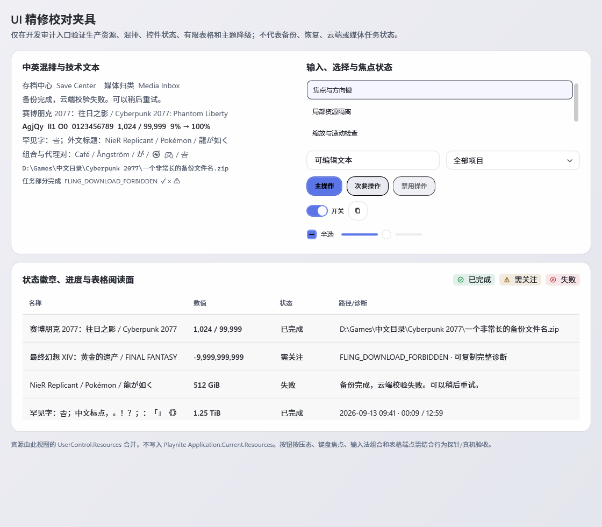
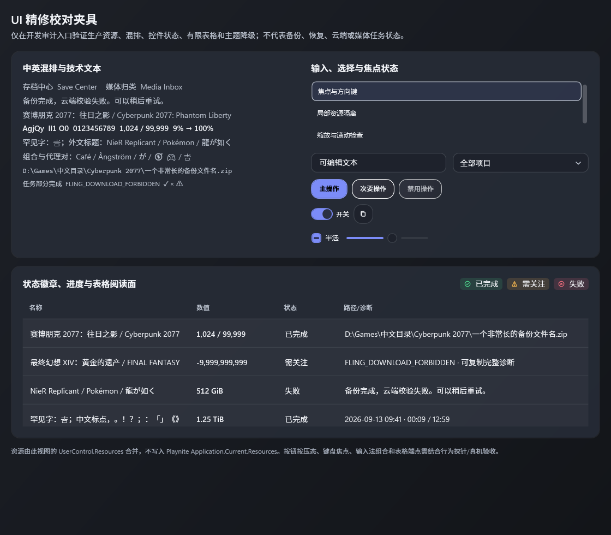

# R03-01 当前 main 落字复核

日期：2026-10-12
状态：已满足（当前 main 的 WPF 落字输出与定向测试已复核；真实宿主字体仍未验）

## 源码与测试身份

- 当前 `main` 为 `8e71feb41aeb20738aa80f0cbb5d05d0c6aeb0af`。与上一完整 Release 源码身份 `4d166f017dcba8fbb07980ec21b690267b9ff377` 相比，源码和测试目录没有变化，只有文档/证据提交；本阶段仍按当前 HEAD 显式重建 RenderHarness 与 Playnite 测试项目。
- 本机隔离 SDK `8.0.423`。RenderHarness Release 构建 `0 warning / 0 error`。程序集 SHA-256 `AF1FAFF4ECC4946EFCC520C0A4A2BDAD38FEFA15F40F2116A4C9F7075EB3C9D9`，MVID `d61056ef-12a7-405f-9107-f95c3edec2fa`，ProductVersion `0.6.73+8e71feb41aeb20738aa80f0cbb5d05d0c6aeb0af`。
- Playnite 测试项目以 `GSC_BUILD_COMMIT=8e71feb41aeb20738aa80f0cbb5d05d0c6aeb0af`、`GSC_SOURCE_ROOT` 指向当前 checkout 重新构建。测试 DLL SHA-256 `67DBBE97D0324715BECFDC1FFA4D33A840A0C941BD9AF32EFC8224A5A156AC7A`，MVID `7ad2ea29-c5c1-4f36-a47a-a2f2a0ec5107`，ProductVersion `0.6.73+8e71feb41aeb20738aa80f0cbb5d05d0c6aeb0af`。引用的 Playnite DLL SHA-256 `3B30D8D9FA908C50787557FF61B735E0247B78972249904B5872BF08F2FA83C2`，MVID `ac1d8495-9635-4213-9249-cb519ee035c1`。

## WPF GlyphRun 证据

当前 Release `TypographyDiagnosticsTests` 定向 `11/11` 通过；TRX 已脱敏并保存在 [通过结果](tests/TypographyDiagnosticsTests-current-main-rebuilt.trx)，SHA-256 `630835C9A8B8CC4D51453ABC522CCAB796EBC73F081C676FD9ECCA581E2014D5`。第一轮 `--no-build` 刻意保留为身份负例：[旧程序集结果](tests/TypographyDiagnosticsTests-current-main.trx)，`5 passed / 6 failed`；测试程序集内嵌 commit `f89b160967f8e267eca406bdacacf3f57508d2dc`，而源码根是 `8e71feb...`，`TestRepositoryContext` 因身份不一致拒绝读源码。随后同一项目按当前 commit 重建，完整类 `11/11` 通过；没有改断言来掩盖旧 DLL。

Light/Dark `finesseprobe` 均 exit `0`、报告 `finesse-fixture OK`。两份报告均绑定当前 HEAD `8e71feb...`，DPI 标记为 offscreen logical DIP `1.00`；`WorkingTreeClean=False` 是实际记录值，因为探针运行时本证据目录及 TRX 已在工作树中生成。`git diff 4d166f0..8e71feb -- src tests` 为空，代码/测试身份没有未提交变更。

| 样本 | 候选字体 | WPF 最终 GlyphRun | 证据 |
| --- | --- | --- | --- |
| 中文 `汉` | Noto Sans SC | Noto Sans SC；1 run / 1 glyph，字符存在，非 `.notdef` | `GlyphRunCaptured` |
| 英文 `S` | Segoe UI Variable Text | Segoe UI Variable Text；1 run / 1 glyph | `GlyphRunCaptured` |
| 数字 `9` | Segoe UI Variable Text | Segoe UI Variable Text；1 run / 1 glyph | `GlyphRunCaptured` |
| 罕见中文 `𠮷` | unresolved | MingLiU-ExtB；1 run / 1 glyph，最终 Typeface 含该码点，非 `.notdef` | `GlyphRunCaptured`；候选未命中不等于最终缺字 |
| 组合重音 U+0301 | Segoe UI Variable Text | Segoe UI Variable Text；文本样本 `Café` 有实际组合度量 | `GlyphRunCaptured` |
| 指南针 emoji（补充） | unresolved | Segoe UI Emoji；1 run / 1 glyph，非 `.notdef` | `GlyphRunCaptured` |

报告与 SHA-256：

- [Light 报告](light/ui-finesse-fixture-report.txt)：`9B0F6D4FB2DBD5EF1D283C8D5E99BE30CFFBEC792D386DE7C1F8C60AF5877556`
- [Light 1120×980 DIP 截图](light/ui-finesse-fixture.png)：`16F522E10BE9E0400A5E83261492E91653B2292EC98F103F10A46ED019B648FA`
- [Dark 报告](dark/ui-finesse-fixture-report.txt)：`7691C1984CFCCB2B6DC95B0A8F91066019F2EE23617D3641992F649CDB382379`
- [Dark 1120×980 DIP 截图](dark/ui-finesse-fixture.png)：`1C2A5C3636C24E5DA06101253D722DA71B56E8B87AB702360FCACE2510F8E126`

## 边界与下一步

截图是合成样本上的受控 WPF 绘制输出，不代表真实 Playnite 最终 presented frame、用户安装字体或宿主字体替换，不验证物理 DPI/跨屏、IME/OS 输入、屏幕阅读器、ETW 或宿主性能。没有触碰真实存档、媒体或云端。R03-01 的“候选与最终落字分开、不可获取时不推定命中”条件满足。

推送 R02-08 证据提交 `8e71feb4` 后，Actions run [#936](https://github.com/Nikilua/GameSaveCenter/actions/runs/38262296773) 终态 failure，耗时 `6m19s`，失败 job `114855606547` 的“编译与测试”步骤 exit `1`；CI SDK `10.0.401`，本机 SDK8 结果不替代 CI。annotation 另有 Node.js 20→24 弃用警告。完整 job logs API HTTP403（当前 API rate limit）；job 页要求登录。diagnostic artifact `11752913387`（476 KB，SHA-256 `d78fb86cee5d81520fa81cebe65434cded562c18bd6fda46af0a91b8081bb021`）页面可见，但匿名下载从 suite artifact 路由返回 HTTP404；失败命令、断言和堆栈仍不可读，根因未知，不盲改。

随后 R03 证据提交 `32c0e1e2` 对应 Actions run [#937](https://github.com/Nikilua/GameSaveCenter/actions/runs/38265390606)（job `114866141338`）终态 failure，8m06s 后“编译与测试”exit 1。页面 annotation 仅提供 exit code，并有 Node.js 20→24 弃用警告；artifact 元数据 `GameSaveCenter-build-diagnostics` 478 KB、SHA-256 `31fa1b2bf29661b435ede1c749f854dc358e0e2c2279eb0c72d0a51eb50cd47e`。run/job logs API、artifact 列表 API均HTTP403，job页要求登录；未获得 artifact ID/完整日志，根因未知。当前 workflow 指向 global.json8.0.423，而任务补充基线为CI10.0.401；本run实际SDK未证实，先取得日志再核查，不盲改。

下一可执行复核：按账本推进 R04-03 未保存离开保护独立阶段。R04-01 当前身份行为 `37/37`、R04-02 错误摘要导航 `5/5` 已归档；真实 Windows IME 候选翻页与 Playnite 嵌入输入仍待宿主验证。
