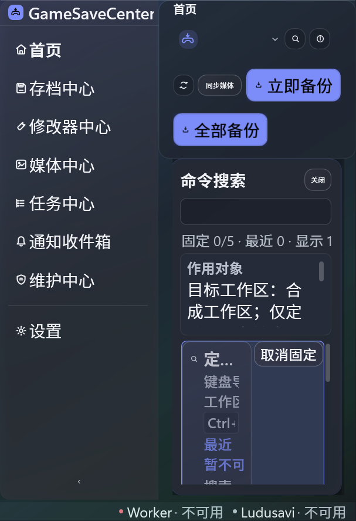
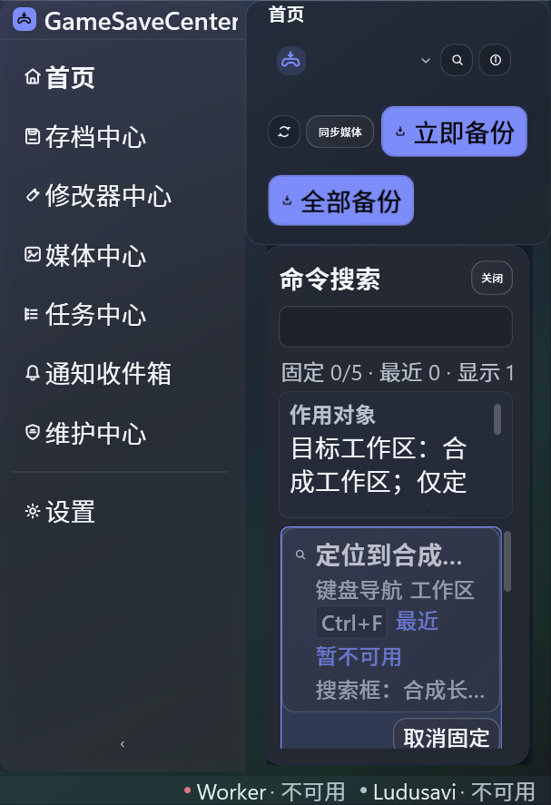
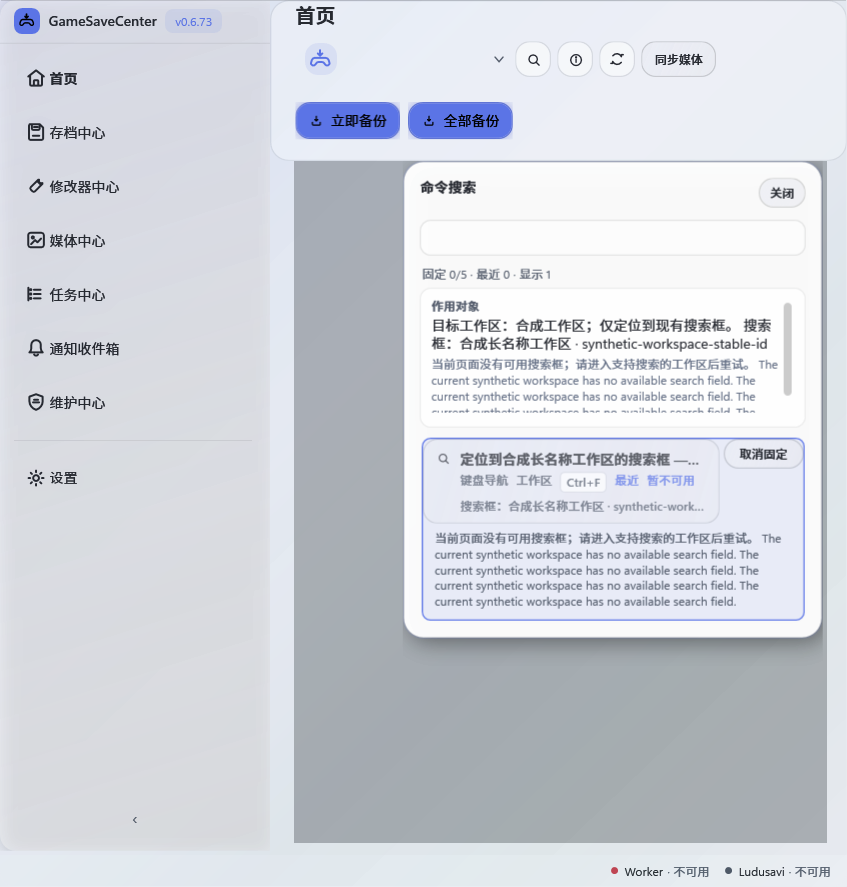

# S00-07 结果精细排版

命令结果分为名称、类别/范围/真实快捷键、作用对象和独立不可用原因。仅搜索框命令显示现有 Ctrl+F；完整名称、稳定对象 ID、上下文与原因保留在 Tooltip/UI Automation。不可用原因放在禁用按钮外，仍可读取。固定按钮按实测宽度和字体换到下一行；保持原命令、固定/最近策略、回收虚拟化和安全复核。

上下文预览使用固定圆角卡片内的有限滚动视口，可 Tab 聚焦并滚动；结果启用像素滚动，200% 长原因可滚到末尾。未修改共享图标几何或业务执行。

## 候选验证

基线44544b2d加未提交源文件，SDK8.0.423 Release编译0警告0错误。10个隔离进程215项：176 pass、39原有资源字典历史skip、0 fail。布局Fact覆盖浅/深主题 × 100%/200%字体 × 620/860/1040窗口，共12组；检查元数据不越过父容器、固定按钮自适应、名称/对象省略与完整辅助说明、独立禁用原因和滚动到底。其余9类验证真实目录、审阅转交、键盘、搜索、偏好、快捷键与资源字典。[源文件和原始/脱敏TRX身份](candidate-identity.json)。

强化父容器裁切断言后，初版在620/200%复现“键盘导航”越界；失败TRX及初始弱断言运行截图保留（强化断言在截图输出前失败）。增加自适应排列后同一断言全12组通过。失败属于未提交原型，没有精确提交身份，不冒充历史版本复现。TRX副本仅脱敏主机/用户标签并规范行尾，原始文件及SHA保留。

## 验收边界

精确实现提交70e421636ad3be5379058645b7564d5a02b25d61复核：SDK8.0.423 Release编译0/0；10个隔离进程215项，176 pass/39原有skip/0 fail，每类至少匹配一项。DLL产品版本与提交一致。[正式身份](formal-identity.json)、[正式编译](formal-build-console.txt)。当前为受控合成WPF验证。真实Playnite页面、物理键盘、IME和物理DPI未验；最终S00-06～08默认.cmd全链待运行，旧4f40e016成功不能替代本批新源码全链。用户原有TRX/TestResults保持未动。
