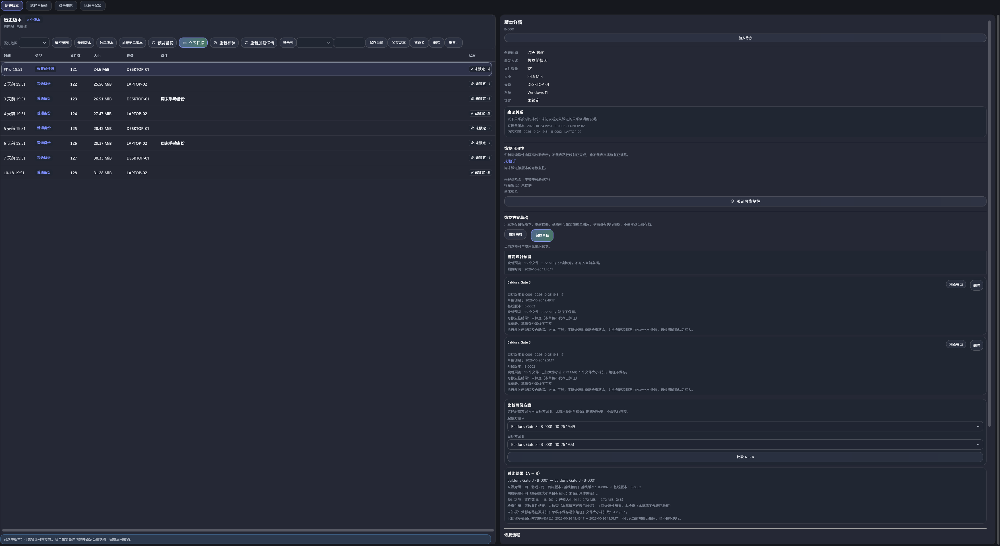

# 存档历史表格高分辨率伸缩回归

## 用户现象与根因

用户报告：另一台 4K 电脑上，存档中心“历史版本”表格拉伸后保持原尺寸，上下出现空白。复核现有 `UI-SCROLL-LAYOUT-REPAIR-20261020` 视口预算发现，`SaveHistoryGrid` 的剩余高度仍被 560 DIP 上限截断；旧 RenderHarness 记录在 `2560×1440` 下也正好测得 560 DIP。

## 修复范围

- `SaveHistoryGrid` 按 PageHost 扣除摘要、框架和详情后的 `historyTableBudget` 分配高度，不再使用固定桌面上限。
- 增加 `900×900` 收缩到 `900×600` 再扩展到 `3840×2160` 逻辑 DIP 的回归，验证表格随窗口增大、缩小后恢复，所选版本详情仍可达。
- 保留表格内部滚动、Recycle 虚拟化和外层页面滚动。没有更改候选表、共享滚动条、当前游戏选框、命令/绑定、错误取消或恢复安全语义。
- 复用 `UI-SCROLL-LAYOUT-REPAIR-20261020` 已有的剩余视口预算；没有重做根裁切或嵌套滚动。Round4 S01 的密度、列管理、视图保存和断点记忆是不同功能，本次不改其状态；实际宿主验收仍按 T02-08 记录。

## 验证

提交 `90bf040567f013f3a8d9ed8667028a4edb2ec524` 的 RenderHarness 全矩阵第二次运行退出 0，`render-qa OK`，无 `PROBLEM`。同一份报告测得历史表格从 `2560×1440` 的 `1101×899 DIP` 增至 `3840×2160` 的 `1741×1695 DIP`；浅色/深色和缩放往返均通过。一次更早的 RenderHarness 运行只有无关的侧栏快速切换探针未 settle，失败报告已在当时保留并完成重跑。

最终候选随后从仓库根目录实际执行：

```text
cmd.exe /d /c "GameSaveCenter-一键构建安装运行.cmd < nul"
```

外层退出码 **0**。build run `20261027T010319835Z-7b052459`、install run `20261027T010317740Z-96e7b91b`、package run `20261027T012406316Z-c7e3272f` 均绑定同一源码身份。SDK `8.0.423`、Release；155 个构建/测试步骤退出码均为 0；XAML 25/25、解决方案 0 warning/0 error。

- 测试总计 1968 项：1910 通过、58 跳过、0 失败/错误/超时/中止；149 份 TRX 计数一致；146 个 WPF 隔离类完成。
- Core 157/157，Worker 400/400，Playnite 源码组 544 通过/18 跳过，WPF 隔离组 809 通过/40 跳过。58 个 skip 与前次已记录的 b05e5696 全链是相同用例集合：1 个真实系统指针用例在发现期默认跳过，另 57 个是既有环境/架构限制，均单独计为 skip，不当作通过。
- Worker `win-x64` 发布成功；ZIP 与 PEXT 均为 45,728,328 字节，SHA-256 相同：`D5A4970893497134188308978E111897FA3AB8E0F9AB074EA451B26CB4A48F6A`。
- 安装目录磁盘程序集的六项 `ProductVersion` 均为 `0.6.73+90bf040567f013f3a8d9ed8667028a4edb2ec524`；各 DLL SHA-256 见 [安装程序集身份](evidence/standard-90bf0405/installed-assemblies.json)。
- Playnite PID 39152 启动成功，Worker PID 42800 从同一安装扩展目录运行；`extensions.log` 记录插件从该目录加载，版本与源码提交相符。未触发备份、还原、媒体或云端业务操作。
- 三入口退出码转交复核仍适用：`GameSaveCenter-Run.cmd`、`GameSaveCenter-一键构建安装运行.cmd`、`scripts/build.cmd` 对注入的 0/7/23 均原样返回，9/9 通过；这些入口自 T00-02 证据后未改动。[T00-02 结果](../build-ui-reliability-20261022/evidence/T00-02/results.json)



第一次同一源码身份的标准根入口在 Worker 的 `NotificationRecordPersistenceTests.Dispose()` 删除临时 SQLite 目录时遇到文件占用，399/400。该失败及 TRX 已保留；同一失败用例定向复跑 1/1、Worker 全套复跑 400/400，随后最终标准根入口整链再通过。没有改动断言或跳过规则，原始失败按实际失败记录，不覆盖成成功。

完整构建摘要、Worker 失败/复测 TRX、RenderHarness 报告和代表性 4K 截图见本目录的 [标准验收证据](evidence/standard-90bf0405/README.md)。当前本机渲染证据为合成数据与逻辑 DPI 验证；没有在用户另一台物理 4K 电脑上验证。该机器上的实机确认仍待回传，不能用离屏截图代替。
