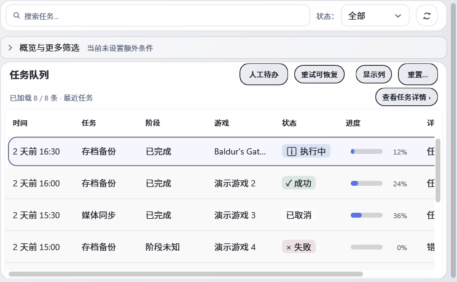
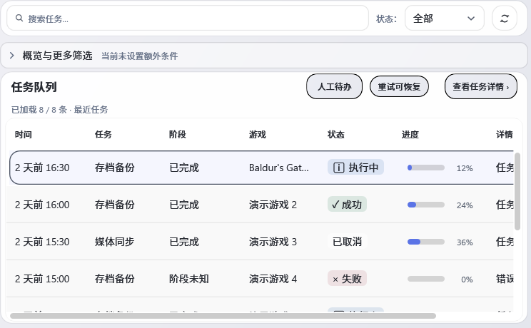
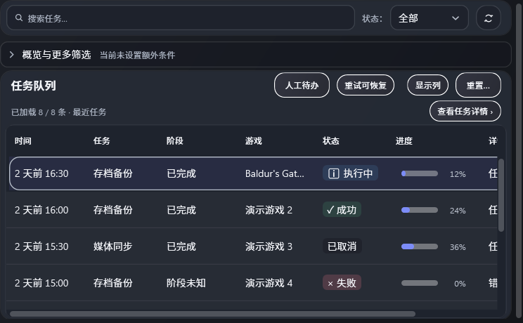
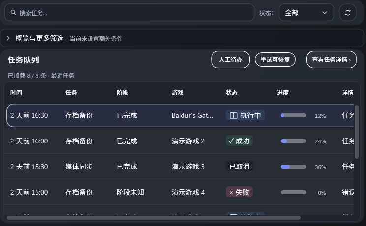

# U00-07 / U06-04 任务页工具栏层级

日期：2026-10-30

## 变更

实现提交 [`d7c4bd5e`](https://github.com/Nikilua/GameSaveCenter/commit/d7c4bd5e3fc2ca83d0393ea51fc7f911cb80100f) 将“查看任务详情”放入任务队列的主要操作行，保留完整文案，并为其提供 Tooltip、UIA 名称和“不更改任务状态”的 HelpText。列显隐和布局重置移入现有任务筛选/表格视图配置行；重置标题改为“重置布局”。已有命令、Binding、筛选、取消、重试、安全语义、滚动条及游戏选框均未改变。

CI 发现旧布局测试仍把重置按钮当作队列标题栏的子元素。修正提交 [`7bc6ab38`](https://github.com/Nikilua/GameSaveCenter/commit/7bc6ab38fa661c11a34086548797f78e02deff43) 只更新该测试：现在检查重置按钮留在配置行，折叠区打开后可见，并在摘要增加内容前后保持高度。生产 XAML 在两个提交间相同。

## 同条件视觉对照

前态以父源 `4a6154587eb716850f8b5abf69f8faac48484d25` 的干净隔离快照构建 RenderHarness；后态来自 `d7c4bd5e` 干净提交。两次使用 SDK 8.0.423、同一假数据和 `2026-10-28T09:00:00Z` 固定时钟、1040×700 DIP 窗口。前态主行右侧有“人工待办 / 重试 / 显示列 / 重置”并在下一行显示详情操作；后态把详情操作并入主行，低频配置操作留在现有披露区。滚动条系统保持原样。

| 主题 | 前态 | 后态 |
| --- | --- | --- |
| 浅色 |  |  |
| 深色 |  |  |

PNG SHA-256、字节数和相对路径见 [`screenshots.json`](screenshots.json)。

前态 RenderHarness 完成构建并生成 394 张图；其完整报告因 Settings 页已有的 normal/dirty 状态说明各两条问题而退出 1。该问题不涉及任务页，保留在 [`render-qa-baseline-report.txt`](render-qa-baseline-report.txt)，不把前态全局 QA 记为通过。任务页截图用于同数据视觉对照。后态干净源 `d7c4bd5e` 的完整 Render QA 退出 0，394 张图、0 PROBLEM；报告和控制台日志分别见 [`render-qa-report.txt`](render-qa-report.txt)、[`render-qa.log`](render-qa.log)。后态的两个 UI 图片已人工核对。

## 行为与源码检查

在精确提交 `7bc6ab38fa661c11a34086548797f78e02deff43` 上按仓库策略逐类启动独立测试进程：

- `CompactWorkspaceTableViewportBehaviorTests`：14/14 通过，0 skip。
- `TaskCenterViewResponsiveTests`：8/8 通过，0 skip。
- `UiLayoutRegressionTests`：20 通过、0 失败、11 skip；跳过项都明确说明断言属于已撤销的“今日工作台”架构，不计通过。
- `KeyboardFocusSourceTests`：5/5 通过，0 skip。
- `ReportedWorkspaceLayoutBehaviorTests`：54/54 通过，0 skip，包含任务队列主行固定高度及配置行重置按钮的浅/深主题检查。

合计 101 通过、0 失败、11 条既有 skip。精确 TRX 与逐类控制台日志见 [`tests/`](tests/)，机器可读计数见 [`tests/summary-exact-source.json`](tests/summary-exact-source.json)。另保留一次将这些类合到同一进程运行的失败 TRX；该次 112 项中 95 通过、6 失败、11 skip，按 `scripts/run-playnite-tests-isolated.ps1` 对测试类的进程隔离方式拆分重跑后，上述五类全部通过。没有删除断言、增加 skip 或修改 SDK 基线。

`scripts/validate-source.py` 通过。生产视图 WPF 静态审查在 UI 提交源 `d7c4bd5e` 上扫描 10 个 XAML、0 错误、23 条既有 warning、4 条 info；提示都在其他视图。该源与最终测试提交 `7bc6ab38` 的生产 XAML 相同。检查日志见 [`source-validation.log`](source-validation.log)、[`wpf-static.log`](wpf-static.log)。

## CI

`d7c4bd5e` 的 push run [41017807712 / #1417](https://github.com/Nikilua/GameSaveCenter/actions/runs/41017807712) 以失败结束：baseline job `123938001209` 与 SDK 10.0.401 job `123938000898` 均在 Playnite 行为测试失败。两主题的同一旧测试把配置行中的重置按钮当作标题栏后代；实际测量显示按钮已按设计隐藏在折叠区，错误地在旧标题栏祖先上测量触发 `TransformToAncestor` 异常。编译、源码结构检查与先行 Worker/Core 测试通过；渲染、打包步骤因测试失败而跳过。保留两个原始 job 日志 [`job-123938001209.log`](ci/job-123938001209.log)、[`job-123938000898.log`](ci/job-123938000898.log)，以及失败诊断 artifact：baseline ID `12960828343`，digest `sha256:363237a4aa34d27de7a763ee5fa3db89c9a57d15f5e0b264cc57a2eb2d6b5047`；SDK10 ID `12961133332`，digest `sha256:86d7af40beb54346e570aaacd114b840481c1f5d28f5460df9070e3f51ded1ab`。没有生成 preview 包。

回归修正提交 `7bc6ab38` 已推送；其 `.github/workflows/windows-build.yml` push run [41022318628 / #1418](https://github.com/Nikilua/GameSaveCenter/actions/runs/41022318628) 的两个适用 job 均终态 success：baseline job `123952247920` 完成15步，SDK10.0.401 job `123952248319` 完成8步，均无失败步骤。preview artifact ID `12965495875` / digest `sha256:3c11e22d03e96cf4a41dbdb31eda1a9a53c1939219b38e4e1a75bd6125496b2d`；baseline diagnostics ID `12965211616` / digest `sha256:53e2ee3a0527c220da41c6a9658aa5a7f8fa09e0f49665fbc6b17538df547755`；SDK10 diagnostics ID `12963550503` / digest `sha256:d8712dd12eef90c147c02bb376ca872a8bdda950d93d773f5043084deb0e0b7b`。三份 artifact 都绑定精确 head SHA `7bc6ab38fa661c11a34086548797f78e02deff43`；完整身份见 [`ci.json`](ci.json)。前一笔纯文档提交 `4a615458` 的 run [41017607656 / #1416](https://github.com/Nikilua/GameSaveCenter/actions/runs/41017607656) 两个适用 job 和三份 artifact 也均已通过/归档，身份见同一 `ci.json`。

## 未验边界与后续门禁

Demo DesignShellView 资源不在当前工作树，不声称与 Demo 直接对齐。RenderHarness 是离屏 WPF 夹具；Playnite 实际宿主呈现、外部 UIA 客户端、实体键盘/IME、跟随宿主主题和物理跨屏 DPI 尚未验证，所以 U00-07、U06-04 仍记“代码完成待验收”。未执行真实存档恢复、媒体删除或云端写入。required-check 名单/分支保护沿用既有 403 “远端待验”状态，不重复试探。

本批不是 Round5 最终冻结候选；本批对精确提交的编译由 SDK8 Release 定向 `dotnet test`、baseline CI 和 SDK10.0.401 CI 完成，未执行独立 `scripts/build.cmd`。中文根入口完整安装启动链及独立 `scripts/build.cmd` 最终复核留给整轮最终源候选执行，不以旧源构建替代。
