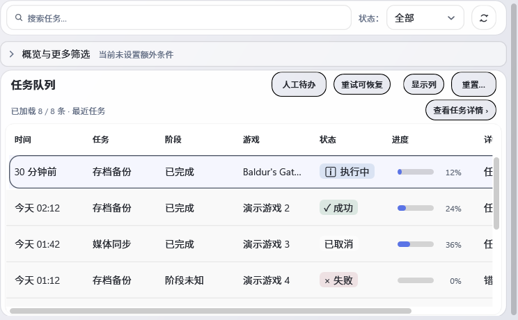
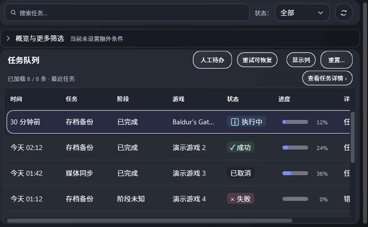

# U03-04/05 输入框状态、搜索和清除

## 实现

生产资源提交：`d1fc1308317fb805d61d67a7dda77d71e0afff18`（`完善输入框禁用与错误反馈`）。

- 移除共享 WPF-UI TextBox 禁用时整控件 `Opacity=0.45` 的做法，改用语义化禁用文字、填色和描边；验证错误优先级高于禁用态，错误框仍有明确描边。
- 将首条验证错误绑定到 `AutomationProperties.HelpText`，不挤占输入内容区域。
- 任务与媒体搜索原有输入绑定、清除按钮及结果摘要分区得到源码回归约束；清除入口仍位于编辑框外层，不覆盖输入区域，数量仍在独立摘要区。
- 不改变任何命令、Binding、错误/取消业务流程、IME/键盘契约或 Playnite 页面结构。生产 TextBox 当前没有对应的忙碌业务操作，因此没有新造 TextBox 忙碌态；现有忙碌命令继续由按钮状态承载。

## 验证

使用仓库本地 SDK `8.0.423`、Release。精确源码提交 `d1fc1308317fb805d61d67a7dda77d71e0afff18` 的隔离重跑共 `32/32` 通过、0 skip、0 fail：

| 验证 | 通过数 |
| --- | ---: |
| `AccessibilitySourceTests` | 5/5 |
| `R09FocusOutlineBehaviorTests` | 2/2 |
| `CommandDirectoryKeyboardBehaviorTests` | 7/7 |
| `GamePickerKeyboardBehaviorTests` | 7/7 |
| `R10SearchShortcutFocusBehaviorTests` | 1/1 |
| `R16SettingsSearchBehaviorTests` | 1/1 |
| `TaskCenterViewResponsiveTests` | 8/8 |
| `TaskSearchTextKeepsVisibleViewportAtExistingFieldHeight` | 1/1 |

每份 TRX 与 SHA-256 见 [`tests-manifest.json`](tests-manifest.json)。初次混合类运行留下的 [`precommit-focused.trx`](tests/U03-04-05-precommit-focused.trx) 保留 29 pass / 3 fail 诊断：一项新源码断言读错了 `Grid.Row` 所在父元素，已修正；两项 WPF 焦点测试在混合STA窗口进程里拿到非激活窗口、`actual=0x0`，其后独立隔离重跑 `R09FocusOutlineBehaviorTests` 为2/2通过。该失败结果保留，不计入通过数。`MediaSearchBoxUsesStretchableColumn` 的唯一既有 skip 明确属于已撤销的“今日工作台”架构，不计通过。

源码结构检查通过；`check-xaml.ps1` 通过26/26；WPF静态检查扫描37个XAML，0 error、26 warning、179 info（既有基线）。RenderHarness Release 编译0 warning/0 error。精确源码SHA的双主题 Render QA 退出码0，394张PNG、0 `PROBLEM`；报告的源码身份为 `d1fc1308317fb805d61d67a7dda77d71e0afff18`。报告写有 `WorkingTreeClean: False`，原因是仓库中另有未跟踪的历史/其他任务证据和TRX；运行时已核对本批产品源码对应 d1fc 提交。完整报告与浅/深主题任务页代表图已归档；报告SHA-256为 `DEF766366B22BC75FE28FE171CECF29187BBC1314A338B6E697D55D072167396`。

## 远端与未验边界

GitHub workflow `.github/workflows/windows-build.yml` 的 d1fc run `40566121765` 仍在运行：baseline job `122407721274` 与 SDK10.0.401 job `122407720730` 都处于编译/测试；没有可用artifact，不能记为CI通过。上一代码提交run `40561836233` 的 SDK10 job `122392618705` 成功、artifact `12762447495`（SHA-256 `073c554698dfc3b3741de806cd42679a2f6caab188253db3bc27ac35706603b6`），baseline job `122392618285` 仍在生成扩展包。适用job/artifact全量快照见 [`CI 清单`](../U02-05-06/ci-runs.json)；required-checks 接口此前返回 HTTP 403，因此标记“远端待验”，不推断分支保护状态。

Render QA 是离屏WPF证据，不代表真实Playnite渲染、Narrator/实际UIA客户端、物理鼠标或实体DPI。未执行真实存档恢复、媒体删除或云端写入。临时渲染副本清理命令被执行策略拦截，未换Shell或其他路径重试；精简输出及磁盘记录见 [`cleanup.json`](checks/cleanup.json)。
