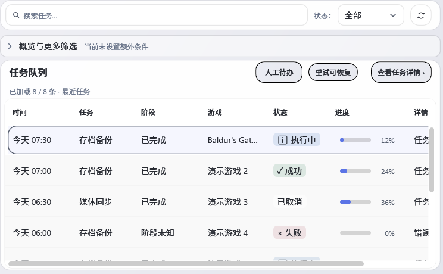
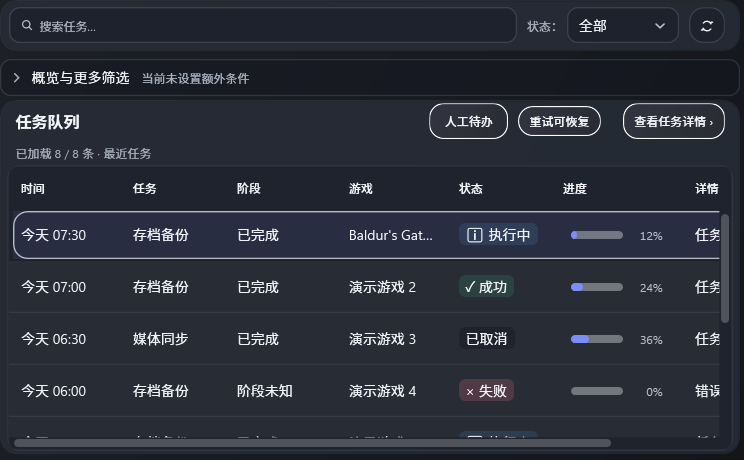

# U05-01 / U06-07 / U09-04 活动工作区重排复测

## 变更范围与源码身份

生产提交 `25bcbf7934575e6aa933373e1f508a1234b28b97`（`只重排当前显示工作区`）只在 PageHost 正在托管某个缓存页面时，对该页应用响应式布局。非当前缓存页保持原尺寸；随后激活时读取当前窗口尺寸。header 的响应式更新仍照常执行。外部注入、并非缓存页的 PageHost 内容不会误入工作区布局。没有修改 XAML、共享样式、游戏选框、滚动条、业务命令或安全操作。

这条实现与 U05-01 页面激活、U06-07 响应式尺寸和 U09-04 切换成本有关。它没有改变既有轻淡入过渡，也没有声称完成页面动效验收。三项状态继续遵循总进度表：U05-01 与 U06-07 为“代码完成待验收”，U09-04 为“进行中”。

`identity.json` 固定源文件、测试、RenderHarness、报告和截图清单哈希。候选改动的 Release 解决方案编译在提交前执行，SDK 8.0.423、0 warning / 0 error；构建诊断记录基线提交 `de9fe37d` 和两条 dirty source path，明确它是含候选源码的预提交构建。该诊断摘要与 SDK/build 日志见 `build/20261102T023155274Z-89cfa826/`。R08 行为组 5/5 通过、0 失败、0 skip；TRX 与控制台输出见 `tests/`。

Source Validation 退出码 0。WPF 静态审查退出码 0，根目录扫描 218 个 XAML、0 errors、208 warnings、1327 info；扫描范围包括仓库中其他临时快照，warning 不归因于本提交。Render QA 与性能报告分别以精确提交 25b SHA 运行，均记录 `WorkingTreeClean=True`。

## 行为与布局检查

R08 页面切换行为组新增回归：Task 页面以 1366 宽度激活时更新；Media 脱离 PageHost 时宽度仍为 0，激活后应用 1040；Task 再次激活后更新至 980。其他用例继续检查快速导航落到最终页、标题/选中状态一致、焦点保持、缓存页面的绑定/选中/滚动状态及标签和筛选保留。没有触发存档恢复、媒体删除或云端写入。

固定 UTC 样本的双主题 Render QA 覆盖 11 个逻辑窗口尺寸及各页面，394 张 PNG、0 PROBLEM；报告 SHA-256 为 `9a97e40fab261a72fc469d24a962c3f6ed4affd955e4e3206383d398d417b4de`。完整文本报告和 394 张原图的 SHA 清单已归档；另留 1040×700 DIP 下 Task 与 Overview 的浅/深主题代表图。采样 DPI 为逻辑 1.00，不推断实体多屏或 Playnite 宿主结果。

## 切换成本观察

在同一候选源码、1040×700 DIP、Light/Dark、固定样本时钟且不强制 GC 的受控 WPF Window 中运行 120 秒动作和 30 秒稳定观察。203 个 `workspace_switch_layout` 样本：中位数 290.28 ms、p95 408.80 ms、最大 544.66 ms。Task 滚动代理 p95 29.77 ms、最大 54.37 ms；程序化搜索更新 p95 3.48 ms、最大 6.55 ms。完整数据与内存/句柄/订阅采样见 `performance/enduranceprobe-report.txt`。

此前 f1a614a8 的两轮同周期页面切换 p95 为 463.20 / 439.21 ms，最大 694.28 / 585.26 ms。本轮单次 p95 低于此前两轮，但计时仍把主题变化和整页同步布局合并，无法据此把变化归因到单一页面或控件；Render 回调也不是呈现帧，搜索由程序设置 Text，不代表实体键盘/IME 延迟。U09-04 保持进行中，待补 U00 原始逐帧与分配基线及真实 Playnite 主机测量。

## 失败对照

第一版候选 Render QA 暴露 Maintenance compact inspector 的 8 个问题：RenderHarness 用外部 PageHost 内容夹具时，布局逻辑把该内容当作缓存工作区再次布局。故障报告为 `diagnostics/first-candidate-render-qa-failed.txt`。恢复父版本源码后同样的离屏报告通过，记录于 `diagnostics/restored-parent-render-qa.txt`；随后把布局调用限制到 PageHost 中引用相同的缓存实例，最终精确提交 Render QA 通过。原失败和对照报告均保留，PNG 副本只保留最终候选输出。

## 宿主与门禁边界

GitHub `windows-build.yml` 的 f1a614a8 精确 run 41371608155 (#1421) 两个适用 job 均已 completed/success，job IDs 为 125043065473 和 125043065257；baseline、SDK10 和 preview artifact 的 IDs/digest 见 [终态快照](ci-f1a614a8-final.json)。de9fe37d 文档提交 run 41376045182 (#1422) 的 job 125056390199 与 125056389840 及所有步骤亦均 success，artifact 见 [终态快照](ci-de9fe37d-final.json)。本提交 25bcbf79 的 run 41379419270 (#1423) 后续已完成：baseline job 125066713824 的15步与SDK10 job 125066714190的8步全部success。三个产物的 ID、digest、head SHA和有效期见[终态快照](ci-25bcbf79-final.json)；原[运行中快照](ci-25bcbf79-query.json)保留为查询时历史。

本批自有输出的路径归属、重解析点/运行占用/引用核对、清理命令和前后磁盘空间见 [清理记录](cleanup.json)；归档文件 SHA 清单见 [files.json](files.json)。

没有在真实 Playnite/FusionX 宿主中运行本批页面，也没有验证外部 UIA 客户端、实体键鼠/IME、物理 DPI、多屏或真实呈现帧。required checks API 曾返回 403，保留“远端待验”并按已有流程交由有权限维护者读取，不重复探测。最终中文根入口完整构建/测试/发布/打包/安装身份/启动，以及独立 `scripts/build.cmd`，仍要在冻结最终候选上执行。

本页复核于2026-11-09：本批自有 `.tmp/round5-u05-237e993f`、`.tmp/round5-u05-batch` 均不在仓库中，未执行删除或声称回收空间；截图、测试日志/TRX、QA报告仍归档在本目录。独立活动页面重排提交 `25bcbf79` 的双SDK CI已终态通过，但本机 `global.json` 要求SDK 8.0.423，当前 `dotnet --list-sdks` 只有 9.0.302，已知本地临时SDK路径亦不存在；不得用SDK9替代，冻结最终候选前须恢复准确的8.0.423工具链。当前分支尚未完成最终中文根入口安装/启动链。
