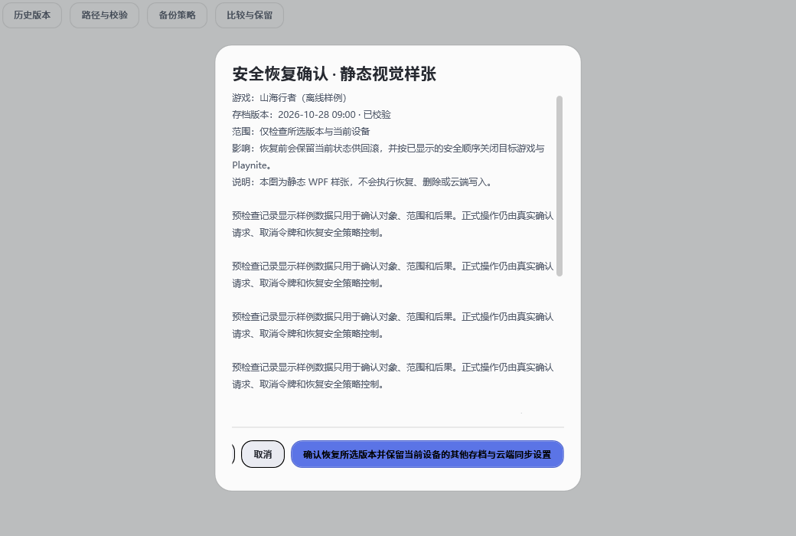
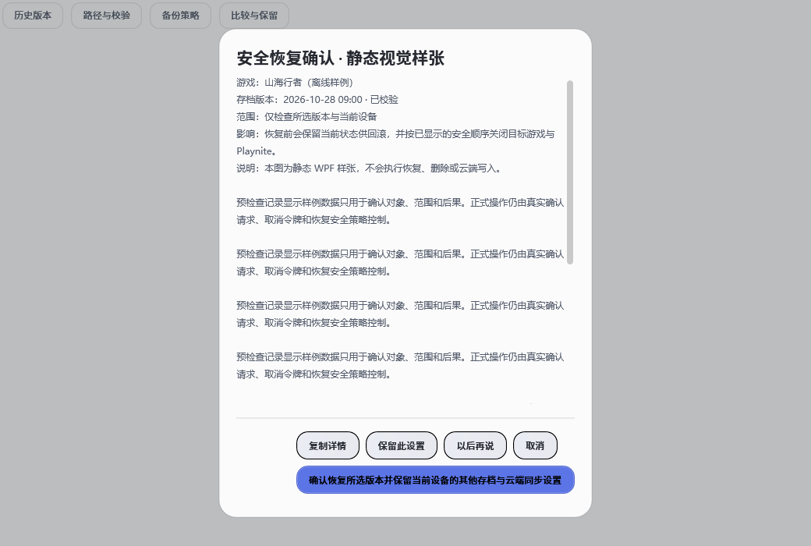
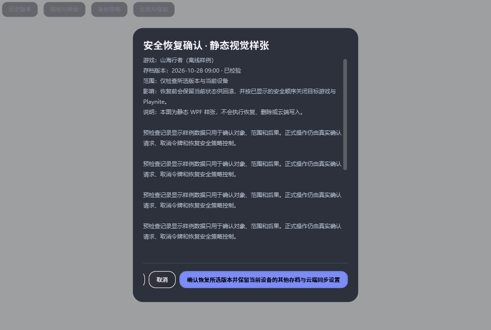
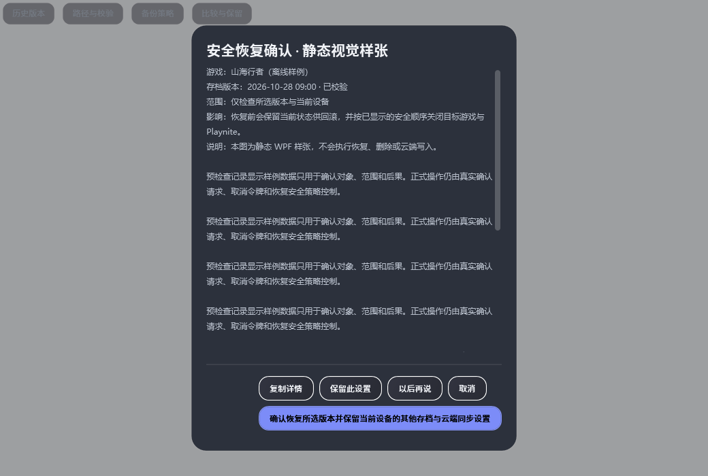

# U09-01：U07-01～04 同数据历史配对

## 历史快照与运行身份

| 用途 | 源码提交 | 源码压缩包 SHA-256 |
| --- | --- | --- |
| U07-01/02 改前 | `ac0afe7267d17333c5735bc69f7595ce2efc75e4` | `F4AFA9296A399976D95C144AAD86272B1FF916F8D6773927FF090EC4BE605583` |
| U07-01/02 改后；同时为 U07-03/04 改前 | `2aba614fddf3f57f632dfeeee134595965a6f313` | `FE827900CB01D006590898B78D97C07A548E04F7D269CFBF2E5B4AC709EB78D3` |
| U07-03/04 改后 | `7c4d07753ec63b32964ebf3bb1f6b66ea7a8724f` | `D745A1B2AC3D226862368B02D352C945735D5D4A1B58A80A3FECE6A4E719F412` |

三份隔离源码快照均用 SDK `8.0.423`、Release 配置构建真实 Worker；随后把最终 `U07PairProbe` 编入对应的 RenderHarness 并重新采集。Worker 与最终 RenderHarness 的退出码均为 0，每份最终 RenderHarness 日志为 0 warning / 0 error。RenderHarness 固定假数据时间为 `2026-10-28T09:00:00Z`。探针 SHA-256 为 `06A49745E624EE3953BB770B1E6B910AAC6476F33A762DA4BFAA84BB2E3018ED`；每个提交的程序集、生产文件和 PNG SHA-256、构建日志哈希及各次捕获退出码见[三个快照清单](captures/manifests/ac0afe72.json)、[中间快照清单](captures/manifests/2aba614f.json)、[最终快照清单](captures/manifests/7c4d0775.json)。

三份快照实际生成 4、12、10 张 PNG，共 26 次捕获；提交证据时按 SHA 去重为 18 张唯一 PNG。测量报告保留各快照的相对源码路径，不依赖临时目录。前两张对话框示例图已人工检查浅、深主题；U07-03/04 的提示气泡与禁用列提示也检查了浅、深主题。其余两种窗口尺寸的完整配对图仍列在截图目录和清单中。

这些是定向历史 WPF 离屏捕获，不是完整 Render QA。设置页隔离实例需要 Playnite 主机字典中的 `BaseTextBlockStyle`；探针提供了仅供渲染用的中性 TextBlock 样式，未启动 Playnite。设置页和任务页用的是生产视图/菜单及假数据。没有触发恢复、媒体删除、云写入或菜单动作。生成的 Popup 图只包含气泡本身；Tooltip 的实际放置以报告中的屏幕坐标为准。Demo 设计树不在当前工作树中，因此这批只证明历史生产改动的差异，不声称完成 Demo 对照、Playnite、外部 UIA、实体键盘/IME 或物理 DPI 验收。

## U07-01 / U07-02：对话框层级与确认动作

相同静态样本包含真实对象、范围、影响、安全说明及长正文；正文仍在独立 `ScrollViewer` 内，垂直滚动为 `Auto`。两主题、1040×700 与 1366×768 DIP 的前后图见[改前](screenshots/U07-01-02-before/)和[改后](screenshots/U07-01-02-after/)，测量报告见[captures/reports/U07-01-02-before/](captures/reports/U07-01-02-before/)和[captures/reports/U07-01-02-after/](captures/reports/U07-01-02-after/)。

1040×700 DIP 下改前动作为 `StackPanel`，五个按钮占同一行；长确认按钮测量边界为 `x=342.67`、宽 `356.67` DIP，截图可见动作区向右溢出并裁切了左侧控件。改后动作为 `WrapPanel`，前四项留在首行，长确认落在第二行 `y=44`，完整处于卡片内。测量结果显示正文视口仍为约 `433×420` DIP，长文本 `726` DIP，滚动继续可用。卡片随第二行动作增加高度，不挤占正文滚动语义。

| 样本 | 改前 | 改后 |
| --- | --- | --- |
| 浅色 1040×700 |  |  |
| 深色 1040×700 |  |  |

1366×768 DIP 的浅、深主题图：[改前浅色](screenshots/U07-01-02-before/dialog-light-1366x768.png)、[改后浅色](screenshots/U07-01-02-after/dialog-light-1366x768.png)、[改前深色](screenshots/U07-01-02-before/dialog-dark-1366x768.png)、[改后深色](screenshots/U07-01-02-after/dialog-dark-1366x768.png)。样张仅移除点击处理器并以静态数据替代对象；确认按钮没有被调用，原业务绑定与危险操作语义未在本证据批次更改。

## U07-03：Tooltip 放置

比较 `2aba614f` 与 `7c4d0775` 的生产 Settings 搜索框。控件及提示正文相同；改前 `Placement=Mouse`，改后 `Placement=Bottom`。固定离屏宿主下，改前 owner 原点为 `(217,251)`、popup 原点为 `(0,23)`；改后 owner 仍为 `(217,251)`，popup 变为 `(217,311)`，对应控件下方。这里的 `(0,23)` 是非激活合成宿主中鼠标位置落在桌面左上附近的测量值，不作为真实鼠标或多屏 DPI 行为结论。

提示气泡和 Settings 宿主的图像在两个提交间 SHA 相同，故只保存一份去重图：[浅色气泡](screenshots/U07-03-04-common/tooltip-light-1040x700-popup.png)、[深色气泡](screenshots/U07-03-04-common/tooltip-dark-1040x700-popup.png)、[浅/深 Settings 宿主](screenshots/U07-03-04-common/)。owner/popup 坐标和 `Placement` 值在[改前测量报告](captures/reports/U07-01-02-after/)与[改后测量报告](captures/reports/U07-03-04-after/)中。

## U07-04：必要列禁用原因

两侧均由生产 `TaskCenterView`、`DataGridColumnVisibilityController` 和相同必要列菜单生成。改前“时间（必要列）”保持禁用，既有 UIA HelpText 为“用于识别对象或状态，始终保持显示。”，但 `ShowOnDisabled=False` 且没有鼠标 Tooltip；因此改前没有伪造空白提示图。改后仍禁用，`ShowOnDisabled=True`，鼠标 Tooltip 与 UIA HelpText 同文。菜单项顺序及任务页/菜单图改前后 SHA 相同，只保存一份共享图；新增提示单独保留[浅色](screenshots/U07-03-04-after/menu-light-1040x700-required-column-tip.png)和[深色](screenshots/U07-03-04-after/menu-dark-1040x700-required-column-tip.png)。任务页和菜单截图在[共享截图目录](screenshots/U07-03-04-common/)；改前无提示、改后有提示的属性和文本见[改前报告](captures/reports/U07-01-02-after/)及[改后报告](captures/reports/U07-03-04-after/)。捕获期间未执行菜单动作。

## 证据文件

- `captures/manifests/`：三个提交的 SDK、源码压缩包、Worker/RenderHarness、生产源码、探针、图片与报告 SHA，以及捕获退出码。
- `captures/reports/`：原始布局、主题、尺寸、滚动、Tooltip 放置及禁用列状态测量。
- `screenshots/`：只保留本批唯一截图；同 SHA 的共享设置页、任务页、菜单及气泡没有重复保存。
- `logs/`：RenderHarness 探针和复采脚本、Worker/RenderHarness 构建日志、首轮失败诊断。构建日志中的隔离源码绝对路径已归一为 `historical-source`。
- `cleanup.json` 与 `sha256.json`：本轮临时输出清理边界、磁盘空间前后及归档文件校验清单。删除命令已完成，C盘实测空闲增加 `834,981,888` bytes、D盘不变；执行器在删除后、保存递归文件数/字节数前结束，因此数量不可恢复，记录为未知而不估算。
- 根目录的 `retry-cleanup*.json`、`retry-disk-before.json` 和 `run-disk-before-attempt-2.json`：前两次捕获尝试的磁盘/临时目录处理记录，作为过程诊断保留；不指向当前存在的临时输出。

U07-01～04 仍为“代码完成待验收”；本配对补足历史画面证据，不替代真实宿主和输入设备验收。U09-01 继续盘点未配对批次。
