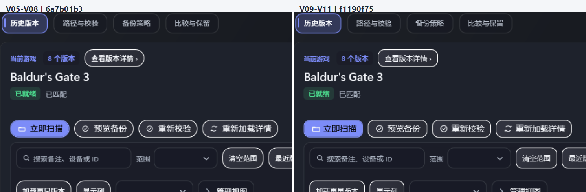

# V09–V11：字体、图标与共享控件

候选源码：`f1190f752525df8aff708bbea547b88823af5145`。本证据将 V05–V08 完成后的存档页与共享原件升级后的生产视图直接对照。完整客户区图像未经裁切、缩放；并排图只在上方增加版本标记，正文维持原始像素大小。

## 同数据前后样本

两侧都使用 RenderHarness 承载生产 `SaveCenterView.xaml`、同一组 `FakeDashboardData(Ready)`（Baldur's Gate 3、8 条历史记录）、采样时间 `2026-11-13T00:00:00Z`、1.0 offscreen DIP 缩放。前侧来自 `6a7b01b3e7fa5862b49cfcb1ff87f701be9b308e`，后侧来自候选 `f1190f752525df8aff708bbea547b88823af5145`。窗口客户区相同：1040×700 窗口对应 744×460 DIP；1600×900 窗口对应 1276×660 DIP。浅色、深色、详情关闭和打开均一一配对。

| 主题 / 窗口 / 状态 | 并排查看 | V05–V08 原图 | V09–V11 原图 |
| --- | --- | --- | --- |
| 深色 · 1040×700 · 关闭 | [打开对照图](comparison/save-history-dark-1040x700-details-closed.png) | [打开前图](../V05-V08/after/save-history-dark-1040x700-details-closed.png) | [打开后图](after/save-history-dark-1040x700-details-closed.png) |
| 深色 · 1040×700 · 打开 | [打开对照图](comparison/save-history-dark-1040x700-details-open.png) | [打开前图](../V05-V08/after/save-history-dark-1040x700-details-open.png) | [打开后图](after/save-history-dark-1040x700-details-open.png) |
| 浅色 · 1040×700 · 关闭 | [打开对照图](comparison/save-history-light-1040x700-details-closed.png) | [打开前图](../V05-V08/after/save-history-light-1040x700-details-closed.png) | [打开后图](after/save-history-light-1040x700-details-closed.png) |
| 浅色 · 1040×700 · 打开 | [打开对照图](comparison/save-history-light-1040x700-details-open.png) | [打开前图](../V05-V08/after/save-history-light-1040x700-details-open.png) | [打开后图](after/save-history-light-1040x700-details-open.png) |
| 深色 · 1600×900 · 关闭 | [打开对照图](comparison/save-history-dark-1600x900-details-closed.png) | [打开前图](../V05-V08/after/save-history-dark-1600x900-details-closed.png) | [打开后图](after/save-history-dark-1600x900-details-closed.png) |
| 深色 · 1600×900 · 打开 | [打开对照图](comparison/save-history-dark-1600x900-details-open.png) | [打开前图](../V05-V08/after/save-history-dark-1600x900-details-open.png) | [打开后图](after/save-history-dark-1600x900-details-open.png) |
| 浅色 · 1600×900 · 关闭 | [打开对照图](comparison/save-history-light-1600x900-details-closed.png) | [打开前图](../V05-V08/after/save-history-light-1600x900-details-closed.png) | [打开后图](after/save-history-light-1600x900-details-closed.png) |
| 浅色 · 1600×900 · 打开 | [打开对照图](comparison/save-history-light-1600x900-details-open.png) | [打开前图](../V05-V08/after/save-history-light-1600x900-details-open.png) | [打开后图](after/save-history-light-1600x900-details-open.png) |

前后原图尺寸完全相同：窄窗 744×460 px、宽窗 1276×660 px。采样和渲染器身份见 [候选运行元数据](reports/after-runner-metadata.json) 与 [状态夹具运行元数据](reports/statefixtures-runner-metadata.json)；图像和报告 SHA-256 见 [文件清单](reports/sha256-manifest.txt)。

## 实际可见变化与复核

- 正文字体按 Demo-first 改为 Segoe UI Variable Text / Display 优先，保留系统级 CJK 与 Windows 回退链；没有捆绑字体。存档标题和表格中的中英文混排更接近 Demo 字体节奏。
- 共用操作图标尺寸增至 18 px，图文间距统一为 4 px；按钮圆角回到 Demo 的 10 px 中号令牌。操作轮廓仍保留稳定的键盘焦点和禁用表达。
- 共享弹层/Tooltip 使用同一浮层表面、边框、圆角与动态主题令牌，收起各自散落的局部样式。透明关闭、高对比主题和主题切换仍通过共享回退路径。
- 内部逐图复核了两种主题、两个客户区尺寸和详情开合。字体变化覆盖标题、标签、输入、按钮和表格；图标/间距/圆角在操作区可直接辨认。长标题与主工具栏没有新增换行，详情和历史行仍保持生产绑定与原信息；差异图按原尺寸显示，未用裁切或改变行数放大观感。

| 校验 | 结果 |
| --- | --- |
| Release 构建及阶段测试 | SDK 8.0.423；Core 157/157，Worker 407/407，Playnite 1,986 通过 / 0 失败 / 58 个已有 skip；157/157 个 WPF 隔离类。未删测试或扩大 skip。 |
| 源码结构与 XAML 静态审查 | `validate-source.py` 通过；生产 XAML 0 errors、26 warnings、164 info，规则保持开启。 |
| 完整 Render QA | 最终候选精确提交 `f1190f752525df8aff708bbea547b88823af5145` 上重新运行通过：334 张 PNG、0 个 PROBLEM。完整采样与提交身份见 [Render QA](reports/render-qa-report.txt)。 |
| 差异与输入隔离 | `git diff --check` 通过。截图在 `WinSta0\GscRound6_*` 隔离桌面采集，运行前后输入桌面都是 `Default`，进程退出码 0。 |

这是受控 WPF 离屏渲染；没有运行 Playnite 真实前台实例，因此不声称验证了宿主主题、物理 DPI、真实鼠标帧率或外部 UI Automation 客户端。页面切换和可中断动画证据在后续 V13–V20 提供。

