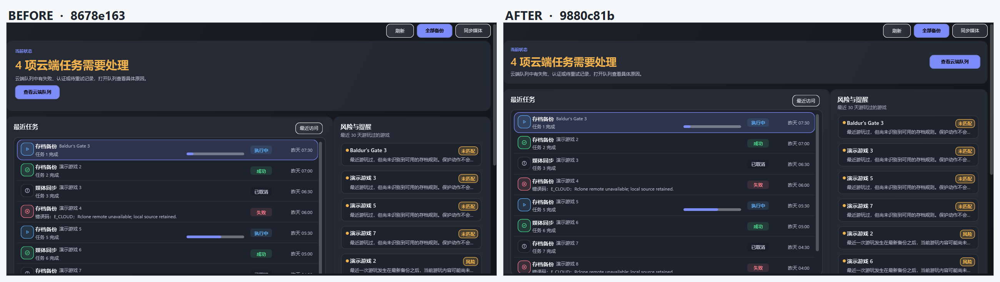
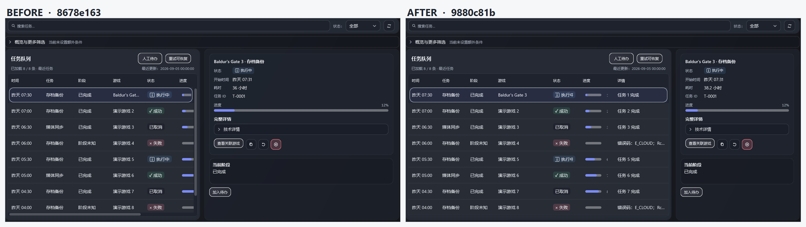
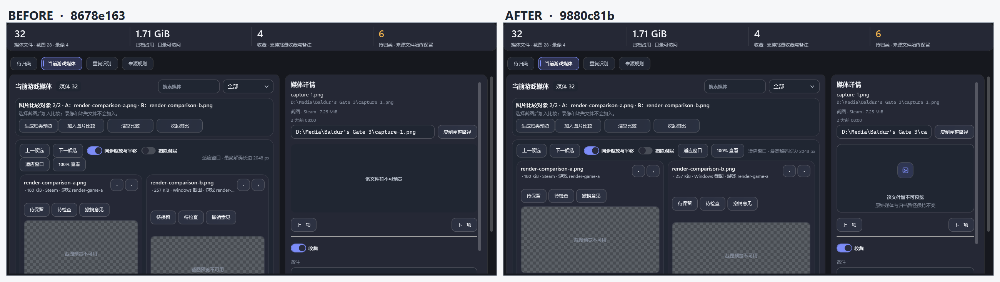
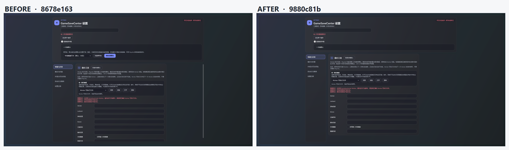

# Round 6 · V21–V28 推广、验收与交付

产品候选提交：9880c81be09365d02b9335a633be95506095c8d9
页面推广实现：ec7a02bea93d27ca054fe66f90574ea733710ebb、9880c81be09365d02b9335a633be95506095c8d9
前态提交：8678e163a92278a74645559f95789c1348941398

## 同数据前后对照

下列生产 XAML 由 WPF RenderHarness 在同一份合成数据、固定时间 2026-11-13T00:00:00Z、深色主题、相同窗口 DIP 与 1.00 logical DIP 缩放下渲染。每张并排图左侧为前态，右侧为候选态；它们是可直接查看的前后效果图，不用于证明动画流畅度。各页完整样本和哈希在 manifest.json。

### 概览 · 1600×900

[1040×700 对照](comparison/overview-dark-1040x700-before-after.png)

主操作与标题并列放在同一行，压缩状态 Hero 高度，为最近任务和风险区留出更多空间。内部对比检查发现第一版在窄宽度下 CTA 会挤压标题；修正为跟随 compactHero 的列布局，并在 680、744、1280 DIP 宽度加入回归断言。最终对照未发现标题与主操作重叠。

### 任务 · 1600×900

[1040×700 对照](comparison/task-dark-1040x700-before-after.png)

大窗详情区固定为约 369 DIP，使队列表格从基线约 517 DIP 扩至约 634 DIP（1366 DIP 宿主宽度的复核窗口）。阶段、动作和字段信息更完整地留在可视范围内。1040 窄窗仍按现有滚动系统横向访问表格。

### 媒体 · 当前游戏详情

[1040×700 对照](comparison/media-current-dark-1040x700-before-after.png) · [收件箱 1600×900](comparison/media-dark-1600x900-before-after.png) · [收件箱 1040×700](comparison/media-dark-1040x700-before-after.png)

收件箱详情固定约 420 DIP，当前游戏详情约 400 DIP；预览占位增加边界、图标与状态层次，原媒体路径和状态语义保留。窄窗维持既有紧凑纵向流，不伪装为并排详情布局。

### 设置 · 2560×1440

[1600×900 对照](comparison/settings-dark-1600x900-before-after.png) · [1040×700 对照](comparison/settings-dark-1040x700-before-after.png)

恢复默认区默认收起，窗口变高时不再自动展开；用户手动展开后仍保持打开。2560×1440 对照可见旧布局的重置卡片占用约 145 DIP，而候选态收起后约节省 87 DIP 的工具位置；1040/1600 基线本来就收起，因此这些尺寸的差异较小。

## 存档页首个示范

V05–V12 已先完成存档页整页重排、共享控件与同数据复核。它的双主题、1040×700/1600×900、常规/详情打开 8 组并排图位于 [V05–V08 对照目录](../V05-V08/comparison/)，生产 WPF 截图和复核记录见 [Round 6 总览](../../README.md)。共享字体字阶、图标、按钮、ComboBox/Tooltip 浮层对照见 [V09–V11 证据](../V09-V11/README.md)。当前游戏选框、滚动条、命令与 Binding、虚拟化、键盘/UIA 和恢复安全语义均保留。

## 视觉质量与行为复核

- 精确候选 Render QA：334 张 PNG、浅/深两主题、0 个 PROBLEM，render-qa OK；源报告为 render-qa-9880c81b.txt，SHA-256 为 F926381D3FD1041EC6958A62F6AB46556E6BB1AACB1C0808C10CCDB8E4CD323B。
- 生产 XAML 静态检查：27 个 XAML、0 error、26 warnings、164 info；与历史基线 warning 数一致。python scripts/validate-source.py 通过。最终测试中，双主题语义状态文本对比断言为至少 4.5:1；大号概览数字和禁用上下文标签有至少 3:1 覆盖。它们是明确控件/颜色的自动检查，不是对每个页面像素的全局测量。
- UI 回归包括概览 CTA 防重叠、任务详情布局、媒体与设置页原有状态和命令路径。测试未删减、未扩大 skip，也未关闭检查。
- 同一 offscreen Render QA 探针中，单次展开 P95 帧间隔从 180.2ms 到 83.6ms；快速反向从 42.1ms 到 44.4ms、最大间隔 66.8ms 到 71.7ms，两个版本都停在正确终态。结果和两份报告哈希见 manifest.json；快速反向样本差异较小且探针会受调度影响，不据此宣称普遍动画更快。当前未单独采集页面操作的 managed-allocation 基线。
- 比较只在 1.00 logical DIP 下运行；这不等同于 100/125/150/200% 物理 DPI、真实输入延迟或用户桌面呈现验证。

## 动态证据：带时间戳的实际 WPF 采样

请打开 [交互式动态采样播放器](../V19-V20/motion-player.html)，或查看 [V19–V20 原始采样说明](../V19-V20/README.md)。播放器基于提交 9097e6c86a8d5a8808eaab03b8b92c1a318b6ece 的实际 CompositionTarget.Rendering 回调和状态快照：147 条记录，136 次真实 WPF 回调、11 条状态快照，按 elapsed 时间回放，不插帧。它是受控 WPF 属性采样，不是视频录屏。页面切换、详情开合/反向、Toast 的最大采样帧间隔分别为 167.7、280.1、38.1 ms；详情测试窗口 IsVisible=false，因此该段不证明详情像素出现在屏幕上。数据没有达到 60fps 的证明标准，也不代表 Playnite 前台或 DWM 帧呈现。

## 本地完整门禁、安装身份与精确 CI

SDK 8.0.423 / Release 下，执行中文入口 GameSaveCenter-一键构建安装运行.cmd（转 GameSaveCenter-Run.cmd）直接退出码 0；0 warning / 0 error，160 份 TRX 共 2,051 项，1,993 通过、0 失败、58 个既有 skip。独立 scripts/build.cmd 同一候选直接退出码 0，计数相同；58 项按 skip 记录，不计入通过。每次都有 157/157 个 WPF 隔离测试类运行。

根入口打包 ZIP 与 PEXT 各 45,744,232 bytes，SHA-256 为 D7D35D49FDAA68AAE7BF35C028B1E87712172158782AC9B584C4921BD1EAE8BE。隔离安装的六个扩展/Worker 程序集 InformationalVersion 均对应 0.6.73+9880c81be09365d02b9335a633be95506095c8d9；安装报告见 [安装身份报告](oneclick-install-report-9880c81b.txt)。Playnite 在全新隔离 profile 中成功作为进程启动，但界面停在首次配置向导；没有进入游戏库，也没有视觉检查插件页面或读取真实用户数据。

精确提交 GitHub run [#1579](https://github.com/Nikilua/GameSaveCenter/actions/runs/43600878377) 的两个适用 job 均 completed/success，全部步骤成功：job 132465154332 编译、测试、打包及 Render QA/WPF 静态审查；job 132465154141 使用 .NET SDK 10.0.401 复核。artifact ID、字节数与 SHA-256 在 [CI 身份 JSON](ci-run-9880c81b.json)，本地运行和测试摘要在 [本地门禁 JSON](local-gates-9880c81b.json)。纯文档提交后不另造“CI 通过”记录。

## 宿主与清理边界

尝试经 CUA 查看隔离 Playnite 窗口时，computer-use kernel 初始化失败（系统找不到指定路径，os error 3），所以没有自动化屏幕观察；实见状态仅为首次配置向导。该限制不推翻隔离安装身份、进程启动、受控 RenderHarness 或精确 CI 结论，也不能被描述成真实 Playnite 页面视觉验收。没有访问真实 Playnite profile、游戏库、真实存档或云端数据。

阶段根构建 scratch 位于 .tmp/round6-v27-rootbuild，已核实归属、路径与无进程占用；按仓库规则调用 PowerShell Remove-Item -LiteralPath -Recurse -Force 时被执行策略以 blocked by policy 拒绝。未尝试替代删除方式。该目录保留在本机；当前安装包、证据和原始诊断也保留。其他任务的 TRX、TestResults 与本轮无关文件没有纳入提交或清理。
