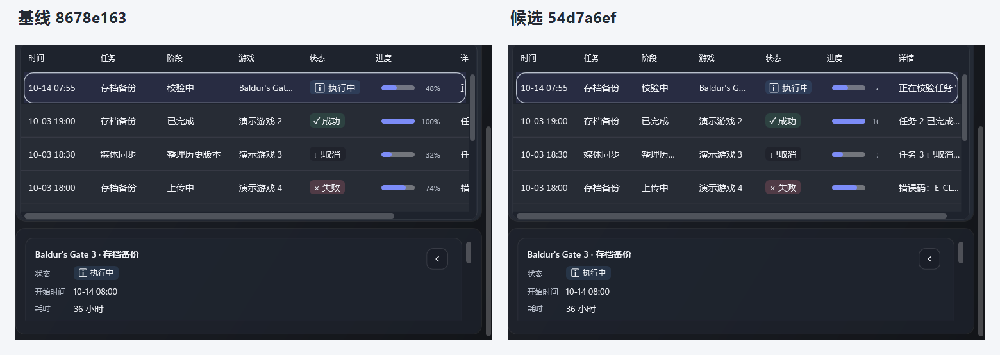
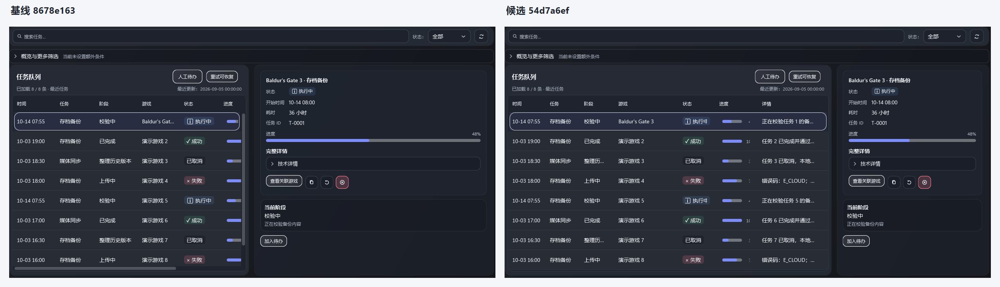

# C01：任务页时间对比一致性

状态：受控 WPF 证据已完成；修复提交 `aa590a1b8c710e0788098b27b128719001aeead3` 的 GitHub Actions 检查尚在运行。

## 发现与处理

旧任务页对比图中选中任务分别显示 36 小时和 38.2 小时。定位发现，合成运行任务没有提供 `ElapsedSeconds`；`TaskStatusDto.DurationDisplay` 在该字段为空时回退计算 `FinishedUtc ?? DateTime.UtcNow`。原合成样本也存在运行状态搭配“已完成”消息、完成进度不一致的情况。这说明旧对比数据不稳定，不构成生产计时缺陷证据。

在 RenderHarness 中增加了独立任务比较夹具：运行、成功、失败、取消各两条；固定所有时间戳、耗时、进度、阶段、消息、结束时间和错误字段。运行样本提供固定 `ElapsedSeconds` 和非终态进度。生产计时、生产 XAML、命令、Binding 与恢复安全语义均未修改，旧截图仍保留。

## 可复现结果

- 基线源码：`8678e163a92278a74645559f95789c1348941398`
- 候选源码：`54d7a6efa1d7438575ca5ca0ff29d098654e6754`（继承产品页面候选 `9880c81be09365d02b9335a633be95506095c8d9`）
- 构建：同机 SDK `8.0.423`，Release；两版 RenderHarness 构建均 0 warning、0 error。
- 样本：`2026-10-15T12:00:00Z`；深色主题；1040×700 和 1600×900 DIP；每次 8 条任务。
- 渲染：两次直接退出码均为 0。各自在 `WinSta0` 私有桌面运行，渲染前后输入桌面都是 `Default`。
- 快照：两版完整 `task-sample-snapshot.tsv` SHA-256 均为 `979BD8EA59BB948F039059D8F4E920DDB289AA355A8A45741BB0A8A7392D5BBE`。
- 选中样本：`T-0001` 执行中、36 小时、48%、校验中。

## 并排截图

以下图片为生产 `TaskCenterView` 的受控离屏 WPF 渲染。它们不代表真实 Playnite 窗口、物理 DPI 或实体键鼠输入验收。

### 1040×700 DIP

### 1600×900 DIP

## 原始文件

- [完整字段快照](task-sample-snapshot.tsv)
- [基线渲染报告](baseline-task-evidence-report.txt) 与 [候选渲染报告](candidate-task-evidence-report.txt)
- [基线运行元数据](baseline-runner-metadata.json) 与 [候选运行元数据](candidate-runner-metadata.json)
- [图片与快照 SHA-256 清单](manifest.json)
- 原始图：[`baseline-task-dark-1040x700.png`](baseline-task-dark-1040x700.png)、[`candidate-task-dark-1040x700.png`](candidate-task-dark-1040x700.png)、[`baseline-task-dark-1600x900.png`](baseline-task-dark-1600x900.png)、[`candidate-task-dark-1600x900.png`](candidate-task-dark-1600x900.png)

CI：源码候选 `54d7a6efa1d7438575ca5ca0ff29d098654e6754` 的 run #1582（`43706944794`）在 Source Validation 因比较脚本缺 UTF-8 BOM 失败；后续步骤因依赖失败正常跳过。修复提交 `aa590a1b8c710e0788098b27b128719001aeead3` 补齐 BOM，并已通过本地 `python scripts/validate-source.py`。精确修复 SHA 的 run #1583（`43707721313`）及其两个适用 job 的最终结果将在该 run 终态后补记。
