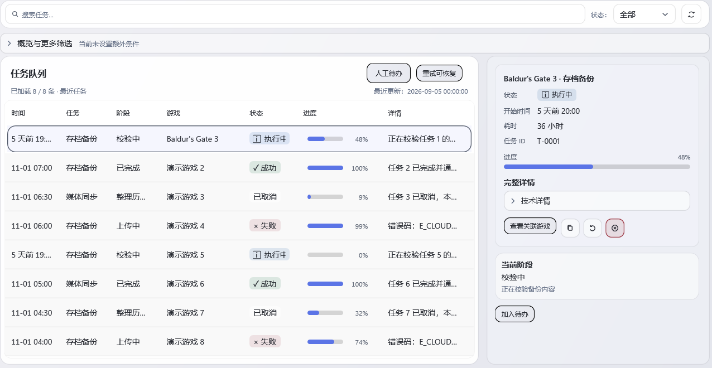
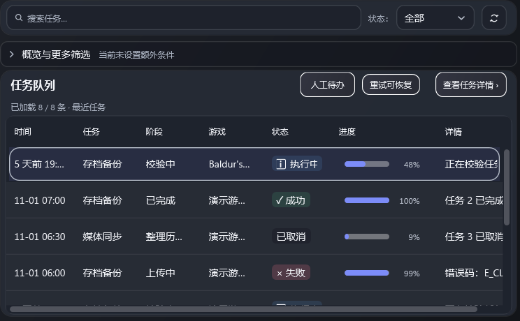

# C05：任务表进度百分比可读性

状态：C05 已在精确提交 `1b462d7302d90d5bdbd3195fbf64d7a2e2d22c06` 上完成受控修复、两个本地完整门禁和适用 GitHub jobs。具体身份与摘要见[candidate-gates.json](candidate-gates.json)。

## 根因与修复

修复前任务表进度列宽为 112 DIP、最小宽度 100 DIP。`DataGridCell` 左右各有 12 DIP 内边距，单元格模板再留 8 DIP 外边距，进度条最小 52 DIP、百分比列 40 DIP。数字 TextBlock 的布局矩形落到单元格可用内容之外：例如 `0%` 在 1040 DIP 测试窗的矩形为 `[96,112]`，可用内容右边界为 100 DIP，超出 12 DIP；`100%`、`48%`、`99%` 也都越界。旧 PNG 与同次生产 WPF 树几何读数一致，排除截图缩放因素。

修复后进度列使用 152 DIP 默认宽、148 DIP 最小宽；单元格为百分比保留 44 DIP、进度条保留 64 DIP。所有数字仍绑定 `ProgressDisplay`，进度条的 `ProgressValue`、UI Automation Name/HelpText 未变；行列虚拟化和已有横向滚动保留。没有改进度值、游戏选框、滚动条系统或任务恢复安全语义。

## 修复前受控基线

- 来源：生产 `TaskCenterView`，SDK 8.0.423/Release，`e3566dbb234388dbb6c413bc1845e1b4490cc0b7` 产品视图；合成 8 行，固定采样时刻 `2026-11-13T00:00:00Z`，同一 TSV SHA：`51B8F8DA60DB737D04560CB69D79D9B2C538E9CEBAA1C67EBBDCF7DE8F413E4A`。
- 私有 `WinSta0` 桌面运行，输入桌面前后均为 `Default`。WPF 窗口实际读数为 144×144 DPI / 150%；PNG 是 96 DPI 的逻辑 DIP 栅格。没有实际 100% 显示器可用，不能把图像栅格称为物理 100% DPI。
- Light/Dark 各覆盖 800×700、1040×700、1366×768、1600×900 DIP。五种标签均出现越过填充边界；800 DIP 横向可滚到末端且选中任务稳定。
- RenderHarness 报告直接退出码 1。新回归测试在同一受控 WPF 树上得到 `6 passed / 1 failed / 0 not executed`，失败诊断已脱敏保存在 `diagnostics/baseline-test-failure.json`。

修复前报告：[几何与滚动诊断](before/task-progress-evidence-report.txt)，[运行身份](before/runner-metadata.json)，[固定任务快照](before/task-progress-fixture.tsv)，[文件 SHA-256 清单](before-manifest.json)。

| 窗口尺寸 | 浅色主题 | 深色主题 |
| --- | --- | --- |
| 800×700 | [PNG](before/task-progress-light-800x700.png) | [PNG](before/task-progress-dark-800x700.png) |
| 1040×700 | [PNG](before/task-progress-light-1040x700.png) | [PNG](before/task-progress-dark-1040x700.png) |
| 1366×768 | [PNG](before/task-progress-light-1366x768.png) | [PNG](before/task-progress-dark-1366x768.png) |
| 1600×900 | [PNG](before/task-progress-light-1600x900.png) | [PNG](before/task-progress-dark-1600x900.png) |

修复前典型截图：

真实 Playnite 前台、物理键盘/UIA 客户端、屏幕呈现帧和真实 DPI 多显示器切换仍未验；该工作只证明受控 WPF 宿主上的布局。

## 修复后受控矩阵

精确候选 `1b462d7302d90d5bdbd3195fbf64d7a2e2d22c06` 在 SDK 8.0.423/Release 上重新运行 `TaskProgressEvidence`，直接退出码 0。浅色/深色各覆盖 800×700、1040×700、1366×768、1600×900 DIP；五种标签在16个主题/尺寸组合中均落在 DataGridCell 的填充内容区内，Automation HelpText 与完整显示值一致。800 DIP 下横向滚动到末尾成功，选中项稳定，行/列虚拟化保持启用。

实际 WPF Window 读数为 144×144 DPI（150%）；截图是 RenderTargetBitmap 96 DPI 逻辑栅格，不能称为实际 100% 显示器验收。本机没有可用的真实 100% 显示器。固定任务快照前后 SHA-256 均为 `51B8F8DA60DB737D04560CB69D79D9B2C538E9CEBAA1C67EBBDCF7DE8F413E4A`。修复后矩阵报告、运行身份、TRX 与哈希见[after-manifest.json](after-manifest.json)和[修复后报告](after/task-progress-evidence-report.txt)。

| 窗口尺寸 | 浅色主题 | 深色主题 |
| --- | --- | --- |
| 800×700 | [PNG](after/task-progress-light-800x700.png) | [PNG](after/task-progress-dark-800x700.png) |
| 1040×700 | [PNG](after/task-progress-light-1040x700.png) | [PNG](after/task-progress-dark-1040x700.png) |
| 1366×768 | [PNG](after/task-progress-light-1366x768.png) | [PNG](after/task-progress-dark-1366x768.png) |
| 1600×900 | [PNG](after/task-progress-light-1600x900.png) | [PNG](after/task-progress-dark-1600x900.png) |

修复后典型截图：

精确候选 `R06TaskProgressBehaviorTests` 为 7 passed / 0 failed / 0 skipped；汇总与原始 [TRX](after/R06TaskProgressBehaviorTests-1b462d73.trx) 一并保存。

## 精确提交门禁

中文一键入口 `GameSaveCenter-一键构建安装运行.cmd` → `GameSaveCenter-Run.cmd` 完整链直接退出码 0；独立 `scripts/build.cmd` 直接退出码 0。两次均使用 SDK 8.0.423/Release，160 份 TRX、2052 项、1994 通过、0 失败、58 跳过、157 个 WPF 隔离类完成。测试跳过数与旧基线相同，没有增加 skip 或关闭检查。

一键链打包并安装清单 0.6.73、插件 DLL 0.6.73.0；ZIP/PEXT 均为 45,744,277 bytes，SHA-256 相同。六个已安装程序集版本身份和 SHA 与本次打包目录逐一匹配。Playnite 启动身份已验证为本次创建的仓库 `.tmp` 隔离 profile；未打开插件页面。启动后进程和隔离 Worker 保持运行，`CloseMainWindow()` 返回 false；遵从仓库既有安全记录，没有重试已知超时的 `--shutdown` 或强杀，故保留该仍占用的 profile。

对另外12个本轮自有临时目录完成规范化根路径、重解析点、外部引用和进程占用预检；它们均在仓库 `.tmp` 内、无重解析点或其他进程引用。指定 PowerShell `Remove-Item -LiteralPath -Recurse -Force` 命令在 shell 启动前被执行策略拒绝，未删除目录，也未改用其他清理方式。逐项保留路径和拒绝状态见[candidate-gates.json](candidate-gates.json)；当前包、失败诊断和引用证据均保留。

精确提交 Actions run [#1592](https://github.com/Nikilua/GameSaveCenter/actions/runs/43787032807)（`43787032807`）的主 Windows 构建 job `133036868868` 与 .NET SDK 10.0.401 复核 job `133036869124` 均为 completed/success，全部步骤完成。三份 artifact 的 ID、大小、digest 和有效期见[candidate-gates.json](candidate-gates.json)。旧 required-check 403 没有重试。

本次门禁没有访问真实用户 profile、游戏库、配置、存档或云端，没有执行实体键鼠、屏幕呈现帧或真实 UIA 客户端验收；受控 WPF 证据不代替 C04 可见宿主短片/物理输入验收，C04 仍待条件。
