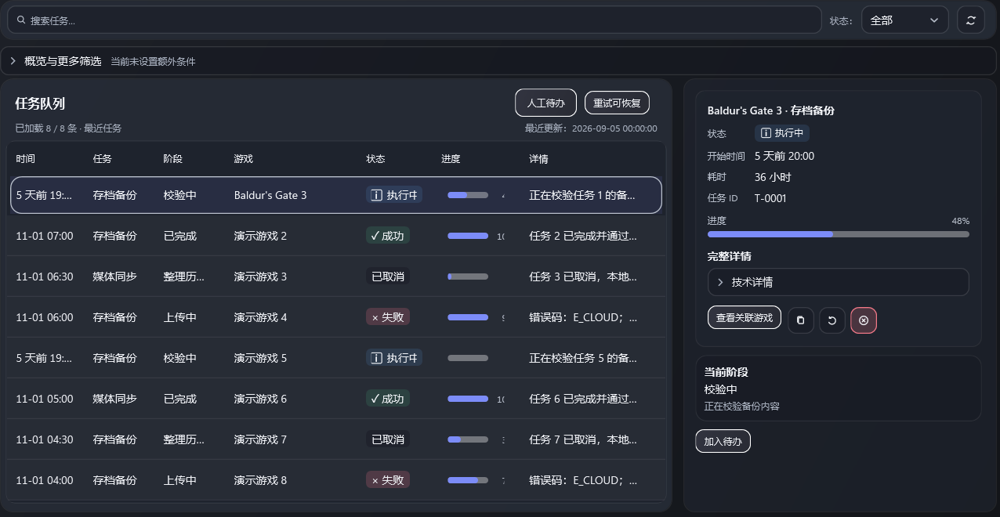

# C05：任务表进度百分比可读性

状态：根因已在受控生产 WPF 视觉树中确认，模板修复和本机验证通过；本目录先保存修复前基线。精确源码提交、最终两种本地入口和 GitHub 适用 job 完成后补入候选证据。

## 根因与修复

修复前任务表进度列宽为 112 DIP、最小宽度 100 DIP。`DataGridCell` 左右各有 12 DIP 内边距，单元格模板再留 8 DIP 外边距，进度条最小 52 DIP、百分比列 40 DIP。数字 TextBlock 的布局矩形落到单元格可用内容之外：例如 `0%` 在 1040 DIP 测试窗的矩形为 `[96,112]`，可用内容右边界为 100 DIP，超出 12 DIP；`100%`、`48%`、`99%` 也都越界。旧 PNG 与同次生产 WPF 树几何读数一致，排除截图缩放因素。

修复后进度列使用 152 DIP 默认宽、148 DIP 最小宽；单元格为百分比保留 44 DIP、进度条保留 64 DIP。所有数字仍绑定 `ProgressDisplay`，进度条的 `ProgressValue`、UI Automation Name/HelpText 未变；行列虚拟化和已有横向滚动保留。没有改进度值、游戏选框、滚动条系统或任务恢复安全语义。

## 修复前受控基线

- 来源：生产 `TaskCenterView`，SDK 8.0.423/Release，`e3566dbb234388dbb6c413bc1845e1b4490cc0b7` 产品视图；合成 8 行，固定采样时刻 `2026-11-13T00:00:00Z`，同一 TSV SHA：`51B8F8DA60DB737D04560CB69D79D9B2C538E9CEBAA1C67EBBDCF7DE8F413E4A`。
- 私有 `WinSta0` 桌面运行，输入桌面前后均为 `Default`。WPF 窗口实际读数为 144×144 DPI / 150%；PNG 是 96 DPI 的逻辑 DIP 栅格。没有实际 100% 显示器可用，不能把图像栅格称为物理 100% DPI。
- Light/Dark 各覆盖 800×700、1040×700、1366×768、1600×900 DIP。五种标签均出现越过填充边界；800 DIP 横向可滚到末端且选中任务稳定。
- RenderHarness 报告直接退出码 1。新回归测试在同一受控 WPF 树上得到 `6 passed / 1 failed / 0 not executed`，失败诊断已脱敏保存在 `diagnostics/baseline-test-failure.json`。

修复前报告：[几何与滚动诊断](before/task-progress-evidence-report.txt)，[运行身份](before/runner-metadata.json)，[固定任务快照](before/task-progress-fixture.tsv)，[文件 SHA-256 清单](before-manifest.json)。

| 窗口尺寸 | 浅色主题 | 深色主题 |
| --- | --- | --- |
| 800×700 | [PNG](before/task-progress-light-800x700.png) | [PNG](before/task-progress-dark-800x700.png) |
| 1040×700 | [PNG](before/task-progress-light-1040x700.png) | [PNG](before/task-progress-dark-1040x700.png) |
| 1366×768 | [PNG](before/task-progress-light-1366x768.png) | [PNG](before/task-progress-dark-1366x768.png) |
| 1600×900 | [PNG](before/task-progress-light-1600x900.png) | [PNG](before/task-progress-dark-1600x900.png) |

修复前典型截图：

真实 Playnite 前台、物理键盘/UIA 客户端、屏幕呈现帧和真实 DPI 多显示器切换仍未验；该工作只证明受控 WPF 宿主上的布局。
